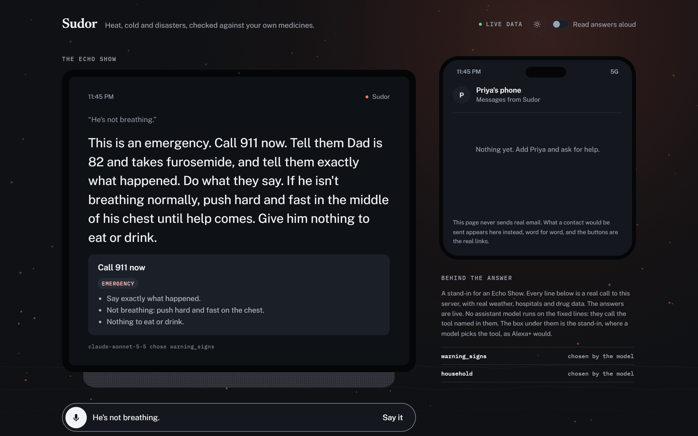
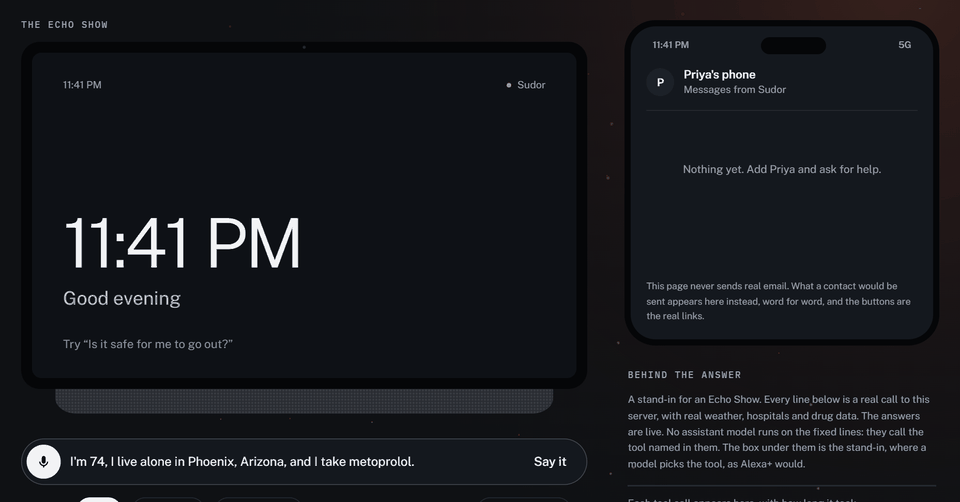
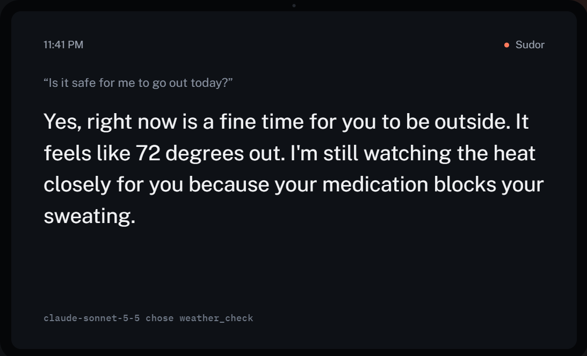
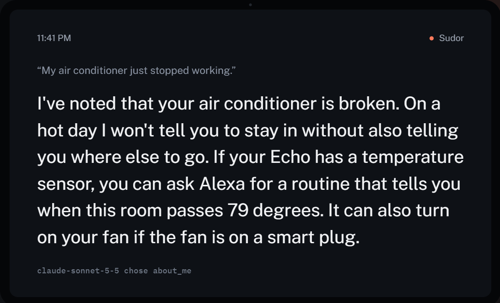
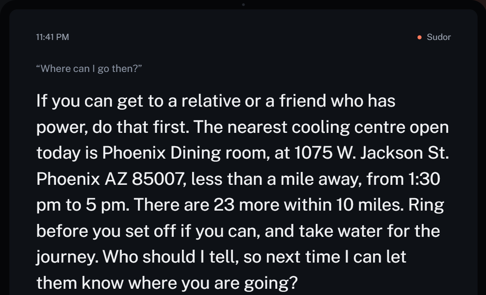
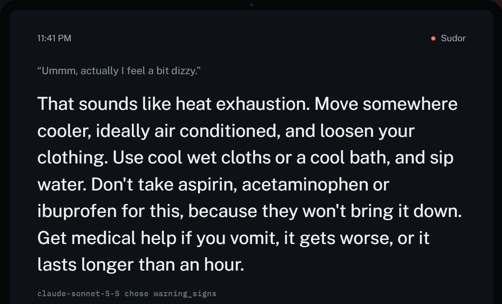
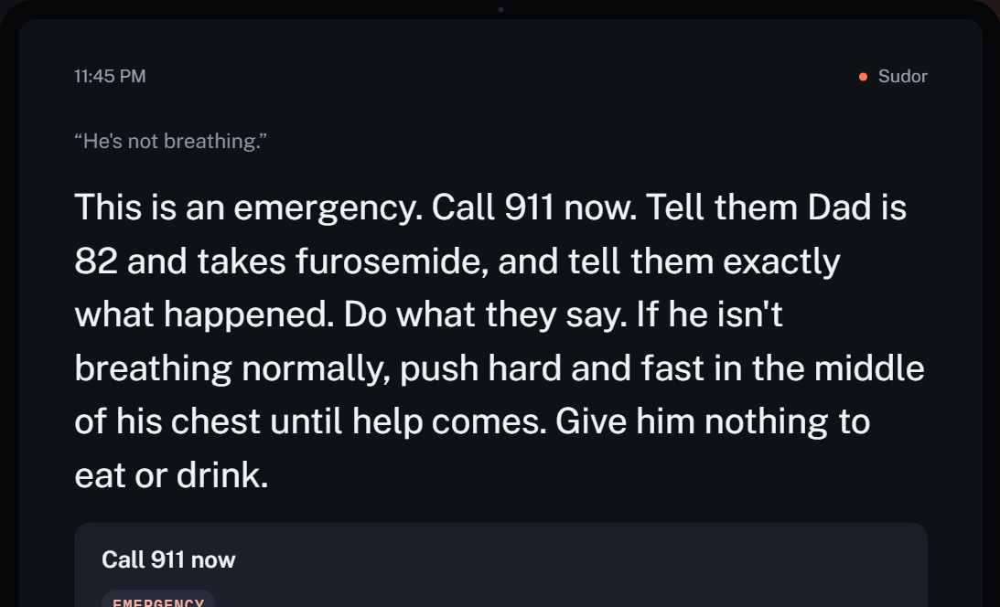
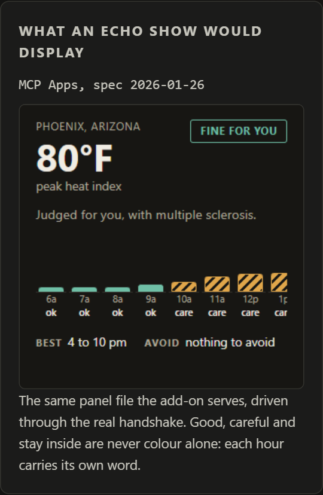
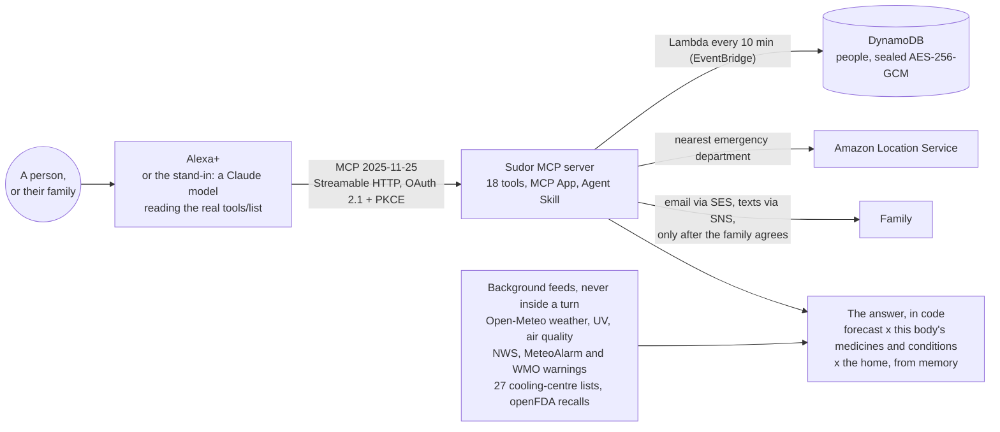

<div align="center">

<a href="https://2f2opzcjui.execute-api.us-east-1.amazonaws.com/echo.html?say=I%20live%20in%20Phoenix%2C%20Arizona&say=She%27s%20not%20breathing"></a>

# Sudor

**Heat, cold and disasters, checked against your own medicines. An Alexa+ add-on that remembers one person's
medicines, conditions, home and town, and answers for that body, not for everybody.**

[](https://github.com/nirbhay221/sudor/actions/workflows/tests.yml)


[](LICENSE)

**[▶ Try it live](https://2f2opzcjui.execute-api.us-east-1.amazonaws.com/echo.html)** ·
**[▶ Watch the video](https://vimeo.com/1238680413)** ·
[Connect any MCP client](#running-it) ·
[Architecture](docs/ARCHITECTURE.md) ·
[Agent Skill](skills/sudor-heat-safety/SKILL.md) ·
[Friction log](FRICTION.md) ·
[Latency](LATENCY.md) ·
[For the judges](#for-the-judges)

<sub>Self-hosted MCP server (spec 2025-11-25, Streamable HTTP, OAuth 2.1 with PKCE) with an MCP Apps panel for the
Echo Show and an Agent Skill. Built for the Build, Ship, Shape: Amazon Developer Hackathon, Alexa+ track.
18 tools by default.</sub>

<br>



<sub>Recorded from the live server in October 2026. Nothing is sped up except the waiting.</sub>

</div>

## In 20 seconds

Water pills, beta blockers, some antidepressants and seventeen conditions change what heat and cold do to a
body. A weather app tells everybody the same thing. Sudor holds one person's medicines and conditions against
their own local forecast and turns that into what to do.

- **"Is it safe for me to go out?"** A verdict for this body, with the reason: "your metoprolol blocks your
  sweating, so you may not feel overheating until it is serious. Keep taking it."
- **"My air conditioner just stopped working."** It stops saying "stay in" when indoors is the danger, and names the
  nearest cooling centre open today, from the county's own list.
- **"She's not breathing."** Call 911 first, then push on the chest. Every emergency, heat or not, leads with the
  number for the country and never with a model's guess.
- **"I live alone."** On a dangerous day with no word by 2 pm, a family member who agreed is asked to check on them.
- **"How do I get ready for a power cut?"** with insulin, oxygen or dialysis: the steps for that body, and the
  warning in force where they live.
- **The model talks; code decides.** Every answer, number and safety line is written by code from live public data
  and published guidance, so no model can soften "call 911" or turn "stay in" into "probably fine".

## Try it now, no Echo needed

Every ▶ opens the [live demo](https://2f2opzcjui.execute-api.us-east-1.amazonaws.com/echo.html) and says the
lines for you, as a new person of its own. A Claude model reads this server's real tool list and plays Alexa+; the
tools run on AWS against today's weather, so the answers follow today's forecast.

| Who | Say | What comes back |
|---|---|---|
| Somebody frightened | ▶ [She's not breathing](https://2f2opzcjui.execute-api.us-east-1.amazonaws.com/echo.html?say=I%20live%20in%20Phoenix%2C%20Arizona&say=She%27s%20not%20breathing) | Call 911 now, push hard and fast on the chest, nothing to eat or drink, and a card that says the same |
| Dolores, 74, on metoprolol | ▶ [Is it safe for me to go out?](https://2f2opzcjui.execute-api.us-east-1.amazonaws.com/echo.html?say=I%20live%20in%20Phoenix%2C%20Arizona&say=I%27m%2074%20and%20I%20take%20metoprolol&say=Is%20it%20safe%20for%20me%20to%20go%20out%3F) | The answer for her, and why: her medicine blocks sweating |
| The same afternoon | ▶ [My air conditioner just stopped working](https://2f2opzcjui.execute-api.us-east-1.amazonaws.com/echo.html?say=I%20live%20in%20Phoenix%2C%20Arizona&say=My%20air%20conditioner%20just%20stopped%20working.&say=Where%20can%20I%20go%20then%3F) | Noted, then the nearest cooling centre open today, by name, address and hours |
| On insulin, in Miami | ▶ [How do I get ready for a power cut?](https://2f2opzcjui.execute-api.us-east-1.amazonaws.com/echo.html?say=I%20live%20in%20Miami%2C%20Florida.%20I%20take%20insulin.&say=How%20do%20I%20get%20ready%20for%20a%20power%20cut%3F) | Insulin keeps best between 36 and 46 degrees, what to do when the power goes, and the warning in force there |
| 80, in Minneapolis, heating broken | ▶ [Is it safe to stay home tonight?](https://2f2opzcjui.execute-api.us-east-1.amazonaws.com/echo.html?say=I%20live%20in%20Minneapolis%2C%20Minnesota&say=I%20am%2080%20and%20my%20heating%20is%20broken&say=Is%20it%20safe%20to%20stay%20home%20tonight%3F) | Tonight's low against the line where an unheated home gets dangerous for an older body, and where to go if it does |
| Multiple sclerosis | ▶ [What does the next week look like?](https://2f2opzcjui.execute-api.us-east-1.amazonaws.com/echo.html?say=I%20live%20in%20Phoenix%2C%20Arizona&say=I%20have%20multiple%20sclerosis&say=What%20does%20the%20next%20week%20look%20like%3F) | The days and hours to stay in, judged for MS, and the days that are fine all day |
| A water pill, in Delhi | ▶ [When should I walk the dog?](https://2f2opzcjui.execute-api.us-east-1.amazonaws.com/echo.html?say=I%20live%20in%20Delhi%2C%20India&say=I%20take%20hydrochlorothiazide&say=When%20should%20I%20walk%20the%20dog%3F) | The safest window today in Fahrenheit and Celsius, and why: the medicine can send sodium too low |

Or type anything into the box on the page, or press **Speak**. The public demo never sends email; what the family
would get appears on the phone beside the screen, with the real agreement links.

## See it

<table>
<tr>
<td width="50%"><br><b>For this body.</b> The same 72 degrees, with the reason it is watched more closely for her.</td>
<td width="50%"><br><b>When indoors is the danger.</b> A broken air conditioner changes every answer after it.</td>
</tr>
<tr>
<td><br><b>Somewhere to go.</b> From 27 published cooling-centre lists, open today, by name and hours.</td>
<td><br><b>First aid at once.</b> The steps, then the signs that turn it into a 911 call.</td>
</tr>
<tr>
<td><br><b>Emergencies lead with the number.</b> For the country they are in, and the nearest emergency department.</td>
<td><br><b>The Echo Show panel.</b> An MCP App. Every hour carries a word and a pattern, never colour alone.</td>
</tr>
</table>

## Why it matters

- **Heat kills the people Sudor is built for.** Of Multnomah County's 72 heat deaths in the 2021 heat dome, 78
  percent were 60 or older, 71 percent lived alone, 94 percent died at home, and almost none had working cooling
  ([Multnomah County](https://multco.us/news/2021-heat-killed-72-people-multnomah-county-most-were-older-lived-alone-had-no-ac)).
  Phoenix recorded 645 heat deaths in 2023.
- **Medicines move the line.** The CDC's clinical guidance names beta blockers and some antipsychotics for blocking
  sweating, ACE inhibitors and some antidepressants for blunting thirst, and diuretics for disturbing electrolytes.
  Heat sensitivity affects 60 to 80 percent of people with multiple sclerosis.
- **Nobody joins the two.** The NWS and CDC HeatRisk scale says heat "tolerated by most" already carries risk for
  the heat sensitive. Replaying July 2026, the answer for a person on metoprolol and furosemide differs from the
  answer for anybody in 36 to 86 percent of waking hours, and in Phoenix 24 of 31 days had no fine hour for them
  against 5 for anybody ([BACKTEST.md](BACKTEST.md)).
- **"Stay in" is wrong when home is the danger.** A broken air conditioner, a power cut, a broken boiler: every
  answer changes, and the family who agreed is told.

## Not a Q&A bot

The hackathon's rules name what makes an Alexa+ entry creative rather than obvious. Each is here, and used for a
reason:

| The rules say | Sudor |
|---|---|
| Agentic workflow across services | Every answer names the next step (`nextAction`): the AC breaks, so where to go, so who to tell. The stand-in follows read-only steps on its own; a [Strands agent](#a-strands-agent-that-follows-the-chain) follows the whole chain and waits for a yes before anything is saved or sent |
| Context-aware, state across sessions | Medicines, conditions, home, cooling and heating, the household, trips, a doctor's plan, a learned limit that only tightens, and family contacts who agreed to hear from it |
| Media support, cards | Cards for emergencies, plans and confirmations (`ui/card.html`) |
| MCP Apps | The Echo Show panel (`ui/window.html`): the full MCP Apps handshake, display modes, and the host's theme |
| Agent Skills | [`skills/sudor-heat-safety`](skills/sudor-heat-safety/SKILL.md), checked by the format's own validator, and readable from the server itself as `skill://` resources |
| Beyond the list | Elicitation to ask which medicine was meant instead of guessing; recalls on the medicines and equipment a person relies on; and a heat check for a farm crew from the sister add-on [Orbita](https://github.com/nirbhay221/orbita), over MCP, with nothing about anyone's health crossing |

## How it decides



**The full design is in [docs/ARCHITECTURE.md](docs/ARCHITECTURE.md)**: nine diagrams GitHub draws and lets you zoom,
covering what runs where on AWS, a voice turn step by step, the decision for one body, the alerts nobody has to ask
for, the DynamoDB record, family consent, security and shipping, with the decisions behind them. A printable copy is
[docs/architecture.pdf](docs/architecture.pdf).

Three things sit between the forecast and an answer, and none of them is a model:

- **The body sets the threshold.** Each medicine is read by mechanism (blocks sweating, blunts thirst, fluid loss,
  burns faster), from the CDC's guidance, its FDA label and the National Library of Medicine's drug classes.
- **The home decides whether "stay in" is safe.** Working cooling, a fan only, broken, too costly to run or power
  cuts; and the same for heating in the cold.
- **What is in force outranks what is usual.** An official warning where they live becomes steps for this person:
  insulin, oxygen, dialysis, whether to leave. A source that could not be read is never counted as safe.

## Measured, not claimed

| What | Result | Where |
|---|---|---|
| Speed, every tool over HTTP | p95 under 40 ms from memory; three tools in a row 35 ms at p95, against Alexa+'s roughly 500 ms | [LATENCY.md](LATENCY.md) |
| One person against everybody, July 2026 replayed | The answers differ in 36 to 86 percent of waking hours across six cities | [BACKTEST.md](BACKTEST.md) |
| Real disasters replayed | The Portland heat dome and Phoenix, July 2023: "your home is too hot to stay in" and the family told | `evals/heatwaves.mjs` |
| Whole conversations | 38 of 38 turns right in the patterns older adults were recorded in | `evals/conversations-last-run.json` |
| Tool choice, from spoken sentences | 95 percent of 100 on the 18 tools Alexa+ is shown, first run 23 October on Opus 5.5 | `evals/golden-core.json` |
| Medicines recognised | 134 of the 286 most prescribed ingredients in the US | `evals/coverage.mjs` |
| Automated checks | 2,835 on every push, on Node 20 and 22, plus the stack, DynamoDB Local and the Strands agent | [`.github/workflows/tests.yml`](.github/workflows/tests.yml) |

## For the judges

The detail below is long because the reasoning is the work. This is the map, in the order of the judging criteria.

- **Tech Implementation.** A self-hosted MCP server on spec 2025-11-25 over Streamable HTTP, the official SDK called
  at runtime (`src/server.ts`, `src/tools.ts`). Account linking is OAuth 2.1 with PKCE. Elicitation, tool
  annotations, output schemas and structured results that name the next step. Feeds are polled in the background, so
  every answer is arithmetic from memory.
- **Design.** Written to be heard once, often by somebody frightened: the verdict, the reason in this body's terms,
  the next step, the rest held for "tell me more". Questions say why before they ask, one at a time
  ([How the conversation is designed](#how-the-conversation-is-designed)).
- **Potential Impact.** A measured, recurring killer, concentrated in a group that can be named
  ([Why it matters](#why-it-matters), [Who this is actually for](#who-this-is-actually-for)).
- **Quality of the Idea.** Not a native Alexa+ feature, not a wrapper around a weather app, and every item on the
  rules' creative list ([Not a Q&A bot](#not-a-qa-bot),
  [Why it is not a wrapper around a weather app](#why-it-is-not-a-wrapper-around-a-weather-app)).

The requirements, one by one:

- **Alexa+ track.** A working self-hosted MCP server, and the simulated Alexa+ experience the rules allow while MCP
  add-on access is in preview: the demo page, where a Claude model reads the real tool list, calls the tools over MCP
  and shows the reply ([An Alexa+ stand-in](#an-alexa-stand-in)). The server is the one Alexa+ would call.
- **Under 500 ms.** Under 40 ms at p95 for every in-memory tool ([LATENCY.md](LATENCY.md)).
- **Setup and run instructions.** [Running it](#running-it), and [`deploy/README.md`](deploy/README.md) for AWS.
- **Built in the window.** First commit 15 September 2026, after the 31 August start.
- **Third-party data.** Every source in [What is real, and what is not](#what-is-real-and-what-is-not), and the terms
  of data from other countries in [Outside the United States](#outside-the-united-states).
- **AWS.** EC2 behind an API Gateway HTTP API, S3 and SSM Run Command for deploys, SSM Parameter Store for keys, a
  DynamoDB table for people, the alert check as a Lambda started by EventBridge Scheduler every ten minutes, CloudWatch
  alarms, SES for family email, SNS for urgent texts, Amazon Location Service for the nearest hospital, all in CDK
  ([`infra/`](infra/)). The agent in [`strands/`](strands/) is built on AWS's Strands Agents SDK. Summary in
  [PRODUCT_FEEDBACK.md](PRODUCT_FEEDBACK.md).
- **Friction log.** [FRICTION.md](FRICTION.md): dated entries from building against the Alexa+ documentation, each
  with what was expected, what happened, the workaround and a suggested fix.


## One afternoon

Dolores is 74, lives alone in Phoenix and takes metoprolol for her heart. It is 110 degrees out, and at two in the
afternoon her air conditioner stops. Her daughter Priya lives across town and agreed to hear from Sudor on bad days.

| Dolores says | Sudor |
|---|---|
| "Alexa, is it safe for me to go out today?" | Not for her: what it feels like outside, that her metoprolol blocks sweating so she may not feel overheating until it is serious, and to keep taking it |
| "My air conditioner just stopped working." | Indoors is no longer the safe place: the home will not cool down tonight. It points her somewhere cool, and Priya is emailed once that the home is too hot to stay in, with nothing about her health in it |
| "Where can I go then?" | The nearest cooling centre open today, by name and hours, from the county's own list |
| Half an hour later, about something else | It asks first: "Earlier I said your home was too hot to stay in. If you are still there, want me to find somewhere cool now?" |
| "Ummm, actually I feel a bit dizzy." | First aid at once, and the signs that mean calling 911 |
| Priya, from her own phone: "How is Mum doing today?" | What to do this afternoon: the home is too hot, call or go round, check the room, make sure she drinks. Never her medicine |

**The model talks; code decides.** The assistant's job is to understand Dolores. Every answer, every number and
every safety line is written by code from live public data and published guidance, so no model can soften "call
911" or turn "stay in" into "probably fine". Three rules hold everywhere: it never says it is safe when it could not
check, it never tells anyone to stop a medicine, and nothing is sent to anyone who has not agreed.

**Tested the way people talk.** Older adults recorded using voice assistants at home repeated themselves, said
"never mind", asked "what about tomorrow though?" and "why?" (arXiv 2403.02421, 2510.06690). Sixteen conversations
in those patterns, played turn by turn against the real tools with the model seeing every earlier answer, got 38 of
38 turns right on Opus on 23 October, as on 16 October (`conversations.mjs`, `evals/conversations-last-run.json`). The first run, of
fourteen, got 33 of 34, and the one it read differently was a fair reading.

## What is real, and what is not

Nothing here is mocked for the demo. Where something stands in for a thing we could not reach, it is named.

| Part | Status |
|---|---|
| MCP server, 18 tools by default | **Real and deployed** on AWS, behind account linking. 2,835 automated checks, run on every push |
| Agent Skill | **Real**: `skills/sudor-heat-safety`, to the open Agent Skills format, passing the format's own validator. Installable as a folder, and readable from the server as `skill://` resources |
| Strands agent | **Real**: `strands/agent.mjs`, on AWS's Strands Agents SDK. It reads the skill from the server and follows each next step. The chain, the yes before a write and the step cap are checked with a scripted model at no cost; the path through Claude needs a key and is not in the automated checks |
| Weather, UV, air quality | **Real, live**: Open-Meteo, worldwide |
| Cooling and warming centres | **Real, live**: 27 open lists published by Maricopa County, New York City, New York State, Washington DC, Harris County, Riverside County, the City of Los Angeles, Philadelphia, San Diego County, Maryland, San Antonio, Columbus, Cuyahoga County, Rhode Island, Toronto, British Columbia, Milwaukee, Chester and York Counties in Pennsylvania, Johnson County in Kansas, Lake County in Illinois, Ramsey County in Minnesota and Lincoln; and four for the cold, the warming centres published by Missouri's health department, Philadelphia, Cook County and DeKalb County. Everywhere else the answer gives open shelters and the 211 line |
| Power already out at the address | **Real, live, where a list is published**: California's Office of Emergency Services, Duke Energy (the Carolinas, Florida, Indiana, Ohio and Kentucky) and BC Hydro. Where only county counts are published (Maryland, Pennsylvania, Ohio, and Alliant Energy in Iowa and Wisconsin) a large outage in the county is said as the county, never as the street |
| Official warnings | **Real, live**: the National Weather Service in the US, MeteoAlarm in Europe, INMET in Brazil, SACHET in India, and the WMO Severe Weather Information Centre elsewhere. In the US also the Weather Service's 7-day HeatRisk, the hurricane centre's cones and river flood forecasts |
| Medicines | **Real sources**: the CDC's clinical guidance on heat and medications, and the National Library of Medicine's RxClass for every other name, by drug class. Brand names from the regulators of India, Canada, France, Brazil, Italy, Spain and the United Kingdom. Measured against the 286 most prescribed ingredients in the US (ClinCalc, 2024): 134 recognised; the rest are mostly drugs the CDC lists no heat effect for. `node evals/coverage.mjs` re-runs it |
| Medicine and equipment recalls | **Real, live**: openFDA drug and device enforcement reports |
| Nearest emergency department | **Real**: Amazon Location Service, confirmed against Medicare's hospital list in the US |
| Emails to family | **Real**, through Amazon SES, only after the recipient agrees. The account is in the SES sandbox (production access requested), so today it reaches verified addresses only. The public demo never sends email; it shows the message on a phone panel instead |
| Text messages to family | **Real code**, through Amazon SNS, for urgent messages only, to a number the family member typed in themselves. Switched on; while the account's SMS is in its sandbox only verified numbers receive them |
| The talking demo | **Real model**: Claude Sonnet 5.5 reads the server's real tool list and picks a tool, as Alexa+ would. When no model is available, plain word rules pick instead, and the screen says which. Speech in and out is the browser's own |
| Alexa+ itself | **Not available to us.** MCP add-on access is in preview. Routing measured on the demo is that model's, not Alexa+'s |
| Phone calls | **Not built.** It cannot ring anyone, and says so |

**Where it works:** anywhere. The United States is matched first when a place is ambiguous, because that is where
Alexa+ is sold. Outside it, the emergency number is the local one (999 in London, 112 across Europe, 000 in
Australia), temperatures are said in Celsius as well, and the US shelter list and 211 line are replaced by the local
council.

## The full write-up

Every part of the design, with the reasoning and the sources. Each section opens on its own.

<a id="the-problem"></a>
<details>
<summary><b>The problem</b></summary>

A heat advisory is written for everyone, and everyone is the wrong threshold for a lot of people.

* The CDC names adults 65 and over, pregnant people and people with chronic conditions as more
  prone to heat illness
* Common medications change how a body handles heat: beta blockers and some antipsychotics block
  sweating, ACE inhibitors and some antidepressants blunt thirst, diuretics disturb electrolytes,
  and thiazides and some antibiotics make skin burn faster
* Heat sensitivity affects 60 to 80 percent of people with multiple sclerosis
* Heat is the usual trigger for erythromelalgia flares, and the standard cooling advice, ice, damages
  their skin
* A spinal cord injury takes sweating away below the injury
* On hot afternoons ozone rises, which is hard on heart and lung conditions

The NWS and CDC HeatRisk scale says it plainly: heat that is "tolerated by most" already carries
risk for extremely heat-sensitive people. Nothing holds a person's own medications and conditions
against their own local forecast and turns that into a plan for the day.

</details>

<a id="what-it-does"></a>
<details>
<summary><b>What it does</b></summary>

Real output from `probe.mjs`, against live Phoenix, Arizona weather on 12 September 2026, for
someone who said they take metoprolol and lisinopril and have multiple sclerosis:

```
"Alexa, when should I take a walk today?"

"It stays hot for you all day, with multiple sclerosis. If you need to go,
 9 to 10 pm is the least risky, heat index about 91, and ask me what
 precautions to take."
```

```
"Alexa, I have to go out now."

"It feels like 100 degrees right now. Keep it as short as you can, and stay in
 shade or air conditioning on the way. Cool down before you go, and take something
 to stay cool, like a cooling vest, a neck wrap or a cold drink. If you or anyone
 with you becomes confused, slurs their words or faints, that can be heat stroke:
 call 911. I have 3 more, if you want them."
```

```
"Alexa, my dad seems confused and his skin is hot and dry."

"That can be heat stroke, which is an emergency. Call 911 now. While you wait,
 move them somewhere cool and cool them with cool wet cloths or a cool bath.
 Do not give them anything to drink."
```

</details>

<a id="why-it-is-not-a-wrapper-around-a-weather-app"></a>
<details>
<summary><b>Why it is not a wrapper around a weather app</b></summary>

**Who you are decides the threshold.** Sensitivity is graded the way HeatRisk grades people, one
level apart: everyone else, sensitive, and extremely sensitive. The same hour at heat index 84 is
fine for most people, a time for care for someone with diabetes, and better spent inside with MS.
Blocked sweating from a medication puts someone in the extremely sensitive group on its own.

**The plan always names a time.** Every stretch long enough for the errand is scored by its worst
hour, then its hottest. On a comfortable day that is the whole comfortable stretch; on a day that
stays hot for you it is still the least risky hour, with an offer of precautions, because "no time
is safe" leaves a person with nothing to plan around.

**The advice changes where generic advice does harm.** Erythromelalgia gets cool water, never ice.
Kidney disease gets "follow your fluid plan", never "drink more". A medication that blunts thirst
gets "sip on a schedule". Insulin is kept below 86 degrees. Heart and lung conditions get air
quality, and a medication that sensitises skin gets UV.

**It never tells anyone to stop a medication.** Whenever a medication is named as the risk, it says
not to stop or change it because of the heat without asking a doctor or pharmacist.

**The warning signs err toward the call.** Confusion, slurred speech, fainting, hot dry skin or a
temperature above 103 get "call 911, nothing to drink" immediately. Heat exhaustion gets cooling,
sipping water, and help if it lasts past an hour or they vomit. Fainting appears in both official
lists and is treated as the emergency.

</details>

<a id="conditions"></a>
<details>
<summary><b>Conditions</b></summary>

| Condition | Group | What changes | Source |
|---|---|---|---|
| Multiple sclerosis | extremely sensitive | pre-cooling; heat symptoms usually settle within a day, a new one that does not needs a doctor | StatPearls, Uhthoff phenomenon; MS Trust |
| Erythromelalgia | extremely sensitive | cool water or a fan, never ice or cold water | StatPearls; The Erythromelalgia Association |
| Spinal cord injury | extremely sensitive | bring external cooling, sweating is reduced below the injury | Frontiers in Sports and Active Living (2019) |
| POTS, dysautonomia | sensitive | avoid standing still in the heat | Autonomic Neuroscience |
| Heart disease | sensitive | air quality counts; nothing strenuous | CDC |
| Asthma, COPD | sensitive | ozone peaks in the afternoon; action plan and quick relief medicine | AirNow Air Quality Guide for Ozone |
| Kidney disease, dialysis | sensitive | follow the care team's fluid plan | CDC |
| Diabetes | sensitive | insulin below 86 degrees; check blood sugar more often | American Diabetes Association |
| Pregnancy | sensitive | even one day of high heat raises risk | CDC |
| Age 65 or over | sensitive | cooler hours, keep it short; past the limit measured for older adults, stay in | CDC; Wolf et al. (2023) |
| Dementia | extremely sensitive | the person may not notice heat or thirst, so drinks offered and the room checked; the family gets a step of its own, without the condition named | Conte Keivabu et al. (2024); JAMA Internal Medicine (2025) |
| A baby or young child with you | sensitive | the day planned at the child's sensitivity; never left in a parked car; loose light clothes; drinks, not very cold or sugary | CDC, Infants and Children and Heat |
| Sickle cell disease | extremely sensitive | a sudden swing in temperature either way can set off a pain crisis, so the hours to avoid are the ones where it swings | NIH; studies of weather and crises in children |
| Raynaud's | sensitive | cold is the trigger, and air conditioning can be too: something warm even on a hot day | NIAMS |
| Fasting | sensitive | time outside early or after sunset, drinking between sunset and dawn, "break your fast" in first aid | IDF-DAR; review of fasting in kidney disease |
| Hay fever | general | morning and windy days kept short; a thunderstorm in pollen season is warned about | Victoria Department of Health |
| Migraine | general | drink steadily; a forecast pressure drop is mentioned, as "can" | studies of weather and headache |

Plus 72 medications in Sudor's own table, classified by heat mechanism: 57 from the CDC's clinical guidance on
heat and medications, 14 added from the CDC's classes and FDA labels, and acetaminophen from the CDC's September
2025 revision of that guidance, with anything else looked up by class.

</details>

<a id="data"></a>
<details>
<summary><b>Data</b></summary>

Free sources, no API keys.

* [Open-Meteo](https://open-meteo.com) forecast: hourly temperature, humidity, UV index and daylight
  for today and tomorrow, requested in the location's own timezone
* Open-Meteo air quality: hourly US AQI, joined to the forecast by hour
* Open-Meteo geocoding: a spoken city and state, or a US zip code, into coordinates
* [api.weather.gov](https://www.weather.gov/documentation/services-web-api): official watches, warnings and
  advisories for each registered address, polled every ten minutes, including the instruction text written by the
  forecast office that issued them
* [openFDA drug enforcement reports](https://open.fda.gov/apis/drug/enforcement/): open recalls,
  matched against the medicines this person takes, checked every six hours in the background
* [openFDA device enforcement reports](https://open.fda.gov/apis/device/enforcement/): the same, for
  the equipment a hot day is dangerous without. See [Equipment, not only
  medicines](#equipment-not-only-medicines)
* Open-Meteo radiation and wet bulb, on the call already being made, which is what turns a heat index
  into a WBGT. See [The number that knows the sun is out](#the-number-that-knows-the-sun-is-out)
* [FEMA and Red Cross National Shelter System](https://gis.fema.gov/arcgis/rest/services/NSS/FEMA_NSS/MapServer):
  the shelters open right now, nationally, with whether each has a generator, step-free access or takes
  pets. On an ordinary day that is a handful for the whole country, so the list is small enough to hold
  in memory and the distance arithmetic happens here

Measured before choosing the architecture: a forecast call took 420 to 480 ms, the forecast and air
quality calls together 772 ms, and a geocoding lookup 740 to 1000 ms. Alexa+ allows roughly 500 ms
for a whole turn. So nothing external is ever called inside a tool call. Weather refreshes per
location on a 20 minute background timer. A spoken place answers at once ("Looking up Phoenix now")
and resolves in the background, and a server restart finishes any lookup it cut off.

**Times are said where the person lives.** Open-Meteo returns wall clock strings with no timezone
marker, and JavaScript reads those as the server's own local time, which once put "when does it ease
off" five hours out. Every hour now keeps the location's wall clock for speaking and a true UTC
instant for comparing.

The heat index is the NWS Rothfusz regression, the formula behind the official chart, not
Open-Meteo's apparent temperature, because the NWS categories were built on the NWS number.

**Where the medication advice bends the usual rule.** A 2026 scoping review of medication and
heat-related illness in older adults, covering 61 primary studies, groups thiazides, SSRIs and the
renin-angiotensin drugs together as the class where ordinary hot-day advice can do harm: their risk
is hyponatremia, so the danger is too much plain water rather than too little
([Pharmacy 14(3):74, 2026](https://doi.org/10.3390/pharmacy14030074)). Those medicines now carry
their own mechanism here, and it outranks the general electrolyte line, so someone on a thiazide is
told to sip through the day and take something salty rather than to drink more water. A loop
diuretic, whose problem is a different one, still gets the ordinary advice.

</details>

<a id="the-two-classes-that-were-missing"></a>
<details>
<summary><b>The two classes that were missing</b></summary>

Until recently this table had 48 medications and none of them were GLP-1 agonists or
SGLT2 inhibitors. Between them that is Ozempic, Wegovy, Mounjaro, Zepbound, Jardiance
and Farxiga: the most prescribed new drugs in the country and a first line diabetes
class, absent from a product whose entire premise is that a person's own medicines
change what heat does to them. That was a hole rather than a rounding error, and it is
recorded here rather than quietly filled.

Both lose fluid, and neither does it by sweating, which is why they needed a mechanism
of their own rather than being folded into the electrolyte case.

A **GLP-1 agonist** delays gastric emptying, and the reported consequence is nausea,
vomiting or loose stools. That loses fluid twice over: once out, and once because
somebody who feels sick does not want to drink. The literature ties it to significant
dehydration and secondary acute renal impairment, and the standing advice is to drink
plenty to avoid volume depletion.

An **SGLT2 inhibitor** does it through the kidney. Glucose in the urine drives an
osmotic diuresis and free water goes with it. Volume depletion events are measurably
more common in patients over 75, which is much of this audience, and the published note
is explicit that type 2 diabetes already carries a raised dehydration risk in hot
weather. Nobody calls these water pills, so they will not come up when somebody is
asked whether they take a diuretic.

**The advice had to be different, and that is the whole reason this is a section.**
For a thiazide, salt is what left, so an electrolyte drink is the correction. Here
water left by a route that took no salt with it, so the thiazide line would be
confidently wrong. What these get instead is steady plain fluid whether or not they
feel like it, and one escalation: not being able to keep fluids down in heat is a
reason to call somebody rather than wait it out. Forty eight tests exist to hold those
two pieces of advice apart.

</details>

<a id="the-number-that-knows-the-sun-is-out"></a>
<details>
<summary><b>The number that knows the sun is out</b></summary>

Sudor answered with the NWS heat index for a long time. The heat index is the right tool for a great
many things and it is the scale the public knows, and the Rothfusz regression it comes from assumes a
person standing in the shade with a light breeze.

Nobody in this product is standing in the shade. That is the thing they are asking whether to leave.

WBGT, the wet bulb globe temperature, accounts for the rest of it: radiant load from direct sun, and
wind. On a clear afternoon the two disagree by 10 to 15 degrees Fahrenheit, and they disagree in the
dangerous direction, because the heat index is the lower one. For somebody whose medication has taken
their sweating away, being told 88 when the load on their body is 100 is not a rounding error.

It also settles a standards question. OSHA, NIOSH and the ACGIH all write occupational heat limits
against WBGT, not the heat index. The proposed OSHA heat rule triggers at a heat index of 80F *or* a
WBGT at the NIOSH recommended alert limit, and its high heat trigger at 90F *or* the recommended
exposure limit. A product that knows only one of those numbers can answer only half of its own rule.

**Where the numbers come from, and how much to trust them.** True WBGT is a measurement taken with
three physical thermometers, and nobody has those in their garden, so it has to be estimated. Every
estimate is somebody's published approximation with a stated error, so each one is named rather than
blended into a number nobody can check. The dry bulb and the wet bulb are not estimated at all:
Open-Meteo publishes the psychrometric wet bulb directly, on the same call. Globe temperature follows
Hunter and Minyard (1999). Natural wet bulb follows Malchaire (1976). The authoritative method is
Liljegren et al. (2008), which solves the heat balance iteratively rather than fitting a line through
it; this is deliberately not that, it sits within one or two degrees Celsius of it outdoors, and
`approximate: true` rides on every result so nothing downstream can forget.

**What is never said.** A WBGT and a heat index are not the same scale, and this is the easiest thing
here to get wrong. A heat index of 95 is a warm afternoon. A WBGT of 95 is past every occupational
limit there is. "Wet bulb globe temperature 97, against a heat index of 118" is true, reads as
reassuring, and is the reverse of the truth. So the raw WBGT number is never spoken next to the heat
index and never offered as a temperature to compare with the one on somebody's phone. What is safe to
say is the difference between sun and shade, because that is one scale, and it is the only part a
person can act on: stand somewhere else.

</details>

<a id="equipment-not-only-medicines"></a>
<details>
<summary><b>Equipment, not only medicines</b></summary>

A drug recall is half of what can be pulled out from under this customer. The other half is the
equipment a power cut already makes dangerous, and this README already names it: insulin that has to
stay below 86 degrees, an oxygen concentrator that needs a socket, a dialysis chair that needs a
working clinic.

The FDA publishes device enforcement reports on the same API in the same shape, and a Class I device
recall means a reasonable probability of serious injury or death. Live, today, there are ongoing Class
I recalls affecting oxygen concentrators, insulin pumps, CPAP and ventilator equipment, and dialysis
catheters.

The matching problem is genuinely different from drugs, which is why it is a separate module. A drug
has a generic name and openFDA indexes it, so "lisinopril" is a precise query. Devices have no such
field: the only searchable text is `product_description`, free text written by the manufacturer, which
reads like "MAHURKAR 12 Fr High Pressure Triple Lumen Acute Dialysis Catheter, 24 cm, Straight
Extensions, IC Tray REF: 8888102004HP".

Nobody says that to a voice assistant. They say "my oxygen concentrator".

So this matches on equipment category, and the wording is built around that limit rather than
apologising for it afterwards. It can say there is an ongoing Class I recall affecting oxygen
concentrators from a named firm, with the reason, and that the customer should check their model
against the notice. It cannot say "your concentrator is recalled", and pretending otherwise would
either frighten somebody whose device is fine or reassure somebody whose is not. Nine of the tests
exist only to hold that line, because a false alarm lands hardest on exactly the person least able to
absorb one. Only Class I is ever volunteered inside an answer about going outside.

</details>

<a id="tools"></a>
<details>
<summary><b>Tools</b></summary>

18 tools by default. Related actions share one tool, because tool choice gets worse as the list
grows: everything about the person is `about_me`, every change to the family list is `contact`.
With `SUDOR_SCOPE=all` the original, finer-grained tools are listed instead.

**Answers**
* `weather_check` whether right now is fine, a time for care, or better spent inside, and why. Needs no
  arguments: it uses the saved place and medicines. An active official warning is said in the same answer, and
  "stay in" is never said alone when the cooling at home is out
* `plan_my_day` the best time to go out today or tomorrow, and the hours to avoid. Given shift hours, it plans a
  shift, with the OSHA proposed 80 and 90 degree lines and acclimatization for a new worker
* `going_out_now` precautions for going out when it cannot wait, two at a time
* `warning_signs` what to do for the symptoms someone describes, in the heat or the cold. In an emergency it says
  the local emergency number first, names the nearest emergency department, and emails contacts who have agreed
* `storm_prep` the official warning where they live, turned into steps for this person: what to do first, insulin
  and injection pens, equipment that needs power, dialysis, and whether to leave
* `somewhere_to_go` open shelters near this address in the US, or the local council elsewhere, and the nearest
  emergency department
* `get_help` tells every contact who has agreed that this person needs help, or with `status: safe` that they are
  all right. Email, and a text to anyone who added their number. It cannot phone anyone or reach the emergency services
* `log_outing` records how a trip outside went, so the next answer can learn from it
* `what_can_you_do`, `tell_me_more`

**About you**
* `about_me` where they live (a city and state, a city and country, or a zip code), medicines, conditions, medical
  equipment, whether the cooling at home works, the indoor temperature they read out, whether they sleep on the top
  floor, privacy, recalls, and forgetting everything. Several at once. A saved place is not replaced without a yes,
  so "my dad is in Tucson" is never saved as the speaker's own home

**Family**
* `contact` adds, confirms or removes a family member or caregiver. With no address said, it hands back a page to
  type it on. The account holder's yes sends one invitation; nothing else is sent until that person agrees
* `share_my_day` a one-time code so a family member, or a crew lead on Orbita, can see how the day is looking,
  never why

**The longer view** (added on 19 October; the tools above are unchanged by them)
* `plan_my_week` the seven days ahead, judged for this person: which days have hours to stay in, which need care,
  the best day for something they want to do, and, given their working hours, the days their trip to or from work
  falls in stay-in hours, so they can work from home. It reads its own seven-day forecast, so the shared one that
  every other answer uses is untouched
* `heat_patterns` the last week, month or year where they live, counted for them: how many days were too hot or
  too cold, the worst day, the hot season by month, and how often they said they felt unwell. From the Open-Meteo
  historical archive (ERA5), which runs about five days behind
* `doctor_plan` what their own doctor or pharmacist told them for hot or cold days, kept in their words and repeated
  on those days. It never suggests skipping, stopping or changing a medicine: the CDC tells clinicians that any change
  in dose or schedule is individual, and to warn patients against stopping a medicine without a plan
  ([CDC](https://www.cdc.gov/heat-health/hcp/clinical-guidance/heat-and-medications-guidance-for-clinicians.html))
* `my_trips` trips and holidays: the days of a trip judged against their medicines from the forecast there once it
  reaches the dates, otherwise from the same dates last year; the emergency number when it differs from home; and
  past trips kept, so the next one can be compared. Name who from home is going ("Mum and the kids") and each of
  them is judged too

**The people at home** (added on 21 October; nothing above changes for somebody on their own)
* `household` the other people who live with the customer: a partner, a parent of 82 on a water pill, a baby. Each
  is judged with the same rules as the customer, for their own age, medicines and conditions, and the answers about
  going out now and the day end with one line about them, most at risk first: "At home: Mum should stay in 11 am to
  7 pm. Your son should stay in 12 to 4 pm, and never be left in a parked car." With nobody added, nothing in any
  answer changes. Children are kept as an age group only, never a name, an age or a health detail: Sudor is for
  adults and the policy forbids collecting children's information, and the CDC's steps for a baby or a young child
  (shade, drinks, never the car) do not depend on who the child is
  ([CDC](https://www.cdc.gov/heat-health/risk-factors/infants-and-children.html)). HeatWatch, from the University
  of Sydney, lets its users add profiles for family members for the same reason

</details>

<a id="when-the-house-is-the-problem"></a>
<details>
<summary><b>When the house is the problem</b></summary>

A power cut in winter is not an inconvenience for everyone. The CDC puts the indoor floor at 68F and
says a house sitting at 60 to 65F can bring on hypothermia in an older adult, which is a temperature
most people would call chilly rather than dangerous, and it happens slowly enough not to register.
Their first answer is to go and stay with a relative or a friend. `somewhere_to_go` is for the person
who has nobody to ask.

It reads two sources because neither is enough alone. FEMA and the Red Cross publish the shelters
that are **open right now**, which is authoritative, national, free, and carries the three things that
decide whether a building is any use to a particular person: a generator, step-free access, and
whether a pet can come. Someone who will not leave a dog behind is someone who stays in a cold house.
What that feed does not carry is the city hall that opened its library for a cold snap, because it is
built for declared disasters. So every answer also gives 211, by phone and by text, which is the line
that does know about the library.

Three rules, all tested:

* **A failed check is never "nothing is open".** That sentence would send someone back into a cold
  house on the strength of a timeout. It says it could not find out, and hands over 211.
* **A blank in the feed is not a no.** If the generator field is empty and this person runs an oxygen
  concentrator, the answer says the list does not record one and to ask when they ring, rather than
  quietly leaving it out.
* **The relative or friend comes first**, because that is the CDC's own first line, and a test fails
  the build if a shelter name ever appears before it.

### In the heat, when indoors is the danger

The usual answer on the worst days is "stay in", and it is only good advice when in is cooler than out.
Maricopa County's 2025 report on heat deaths found an air conditioner in 94 percent of the homes where somebody
died indoors, and not working in 72 percent of those; nine in ten of the people were over fifty. So Sudor asks,
once a day at most, whether the cooling is working, and remembers the answer (`src/indoor.ts`):

* **The numbers are Health Canada's.** 79F (26C) is its upper indoor limit for adults over sixty, from trials in
  which strain did not rise over eight hours at 26C and rose above it; 88F (31C) is where it says sustained
  exposure should be avoided for anybody heat-susceptible. The CDC's line that a fan stops helping above 90F is
  said to anybody whose only cooling is a fan.
* **It never pretends to measure a room.** If they read out the thermometer, that number is used for three
  hours. Otherwise the live forecast says whether the house can cool at all: a home without working cooling ends
  the day about as hot as outside, so a high of 108 and a night that only falls to 86 is said as exactly that.
* **Sleeping under the roof.** In the 2003 French heat wave, older people whose bedroom was directly under the
  roof had about four times the odds of dying (Vandentorren and others, 2006). Somebody who says they sleep on
  the top floor is told that, with the one thing to do about it: sleep lower down until it passes.

### In the cold, when the heating goes

The winter half of the same question. In Winter Storm Uri, Texas counted 246 deaths, and 158 were hypothermia, many
indoors in homes that had lost power or heat. Hypothermia indoors comes on at temperatures most people would call
chilly, so Sudor now asks about the heating the way it asks about the cooling (`src/indoorcold.ts`):

* **The heating is a saved state:** working, broken, none, `cost` (it works and is kept off for the bill),
  power cuts, or a space heater only. On a cold day with a night at or below 45 and nothing known, it asks once:
  "Staying in only helps if your heating works. Is it working?"
* **The numbers are the NIA's and the WHO's.** 68 is the National Institute on Aging's floor for rooms an older adult
  uses, 64 (18 C) the WHO Housing and Health Guidelines' minimum, and 60 to 65 is where the NIA says hypothermia can
  start in an older body. A reading said aloud is believed for three hours; 55 or below is too cold for anybody.
  Without a reading, the night decides: heating that is out with a freezing night is the danger level for anybody the
  cold is hard on, and a hard freeze (20 or below) for anybody, with "let a tap drip" for the pipes.
* **Who the cold is hard on** is counted from what they have said: 65 or over, a young child, dementia, heart disease,
  diabetes, Raynaud's, sickle cell, or a medicine that blunts shivering (antipsychotic hypothermia is most likely in
  the first week of a new or higher dose, a systematic review found).
* **What to do comes with it:** a relative, a friend or a warming centre first; if they must stay, one room with the
  door shut, layers and a hat, warm food and drink; never the oven, a grill or a generator indoors. A space heater
  gets the three rules behind most heating fire deaths: three feet clear, straight into the wall, off when asleep. In
  the US, heating kept off for the bill gets the LIHEAP line and that a doctor's note can hold off a winter shutoff.
* **The family is told once,** with `checkColdHome`, in the afternoon so there is daylight left to act, and a carer
  checking in hears the winter steps: the room at 68 or more, layers, warm food, and the signs of hypothermia.
* **First aid follows the words, not only the weather.** "My hands are numb and I'm shivering" on a hot day used to be
  answered as heat stroke. Shivering, numbness and frostbite now get cold first aid whatever the weather, and so does
  anything said in a home they have read out as 64 or below.

### Smoke, from the forecast

Smoke used to be said only when an official alert was in force. The hourly US AQI is on the forecast call already
made, so a smoky day is now said whether or not anybody issued one (`src/smoke.ts`). The line is AirNow's 101 for
the groups state health guidance names (adults 65 and over, children, pregnancy, diabetes, heart and lung
conditions) and 151 for everybody. The answer says when it peaks, to stay in with the windows shut and the air
conditioning on recirculate, to make one clean room with a HEPA purifier or a box fan with a MERV 13 filter, and
that only an N95 helps outdoors. And the conflict nobody else resolves: on a hot day without working cooling, a house
shut against smoke becomes too hot, so the answer names the heat as the bigger danger and says to open up or go
somewhere cooled with clean air, as King County's guidance does.

### A disaster, for one person

`storm_prep` already joined a warning to the person's medicines and equipment. It now also says what the disaster
asks of them in particular (`particular` in `src/hazard.ts`):

| Who | What is added |
|---|---|
| Needs help to leave, or a shelter with power | Florida's county special needs registry, which closes to new sign-ups 72 hours before tropical storm winds; Texas's STEAR, by 211; elsewhere in the US, to ask the county |
| Takes medicines, a hurricane coming | In Florida, that insurers must allow early refills once a warning or emergency is declared (Fla. Stat. 252.358); elsewhere, to ask the pharmacist now |
| Home oxygen | A concentrator on battery lasts hours, so spare cylinders from the supplier |
| Older, or heat-sensitive, after a hurricane | The heat once the power is out: after Ida, nine people aged 64 to 79 in New Orleans died of it |
| A flood | A cut in flood water and a tetanus shot; the boil water notice |
| Stairs are hard, a tornado | A ground floor bathroom or closet and a mattress over you; from a mobile home, leave at the watch |
| Heating out or a space heater, in a winter storm | Where to go if the house gets cold, or the space heater rules |
| A young child, dementia, living alone | A week of formula and nappies; somebody to stay and a card in the pocket; a plan told to somebody and a check agreed |
| Pregnancy | Leave early; prenatal records, vitamins and two weeks of medicines; out of flood water; the CDC's urgent warning signs |
| Sickle cell | Cold, stress and too little to drink set off a crisis; a fever of 101 degrees or more is an emergency (CDC) |
| Multiple sclerosis, erythromelalgia | The cooling goes with the power: a cooling vest and a battery fan; for erythromelalgia cool water, never ice |
| Spinal cord injury | A week of catheters and skin care, an autonomic dysreflexia card for whoever treats you, turning on a shelter cot (MSKTC) |
| POTS, Raynaud's, migraine, hay fever | Fluids, salt, compression and a seat in the queue; gloves and hand warmers; an eye mask and earplugs; mould after a flood |
| Fasting | The fast is not required of somebody ill or travelling, and must be broken when it endangers health: leaving home, or heat without power |
| Methadone | Take-home doses and a letter with the dose before the clinic closes, as after Hurricane Helene; in the UK, that an emergency supply never covers it |

**The help that is a country's own** (`src/aid.ts`). The registries, the early refill, the help with a bill and the
number that knows where the warm and cool places are used to be American everywhere. Now each of the twelve countries
Alexa+ is in (October 2026) has its own, checked against its regulator or a government notice:

| | Warm or cool place | If power or leaving matters | Medicine before a disaster | Help with the bill |
|---|---|---|---|---|
| United States | 211 | Florida and Texas registries, else the county | Florida's early refill law, else ask now | LIHEAP |
| Canada | 211 | the electricity company | ask now; many provinces allow an emergency supply | Ontario's LEAP and winter disconnection ban |
| United Kingdom | the council's warm spaces | the Priority Services Register | a pharmacist's emergency supply, up to 30 days, never methadone | the Warm Home Discount |
| Australia | the local council | life support registration, four business days' notice | three days from a pharmacist in most states, never a controlled drug | the retailer's hardship program |
| France | the mairie; Canicule Info Service, 0 800 06 66 66, in a heatwave | the mairie's register of vulnerable people | ask now | the chèque énergie |
| Germany | Wärmestuben, the town hall or Kältehilfe | the electricity company | the pharmacy emergency line, 22833 | no cut-off where life or health is in danger (EnWG 41f) |
| Austria | the town hall | the electricity company | Apothekenruf, 1455 | |
| Italy | the comune; the Health Ministry's 1500 in a heatwave | the electricity company | ask now | the bonus sociale, and the one for electromedical equipment |
| Spain | climate shelters, from the ayuntamiento | the electricity company | ask now | the bono social eléctrico, no cut-off in 2026 |
| Mexico | Protección Civil's temporary refuges, through 911 | the electricity company | ask now | |
| Brazil | Defesa Civil, 199 | SMS alerts on 40199, Defesa Civil on 199 | ask now | the Tarifa Social de Energia Elétrica |
| India | heat action plan cooling centres | the electricity company | ask now | |
| Elsewhere | the local council | the electricity company and the council | ask now | nothing said, rather than something invented |

Family emails follow the same rule, so a daughter in Leeds is not told to call 211.

Sources: [Texas DSHS via the Texas Tribune](https://www.texastribune.org/2022/01/02/texas-winter-storm-final-death-toll-246),
[WHO Housing and Health Guidelines](https://www.ncbi.nlm.nih.gov/books/NBK535294/),
[NIH on hypothermia in older adults](https://www.nih.gov/news-events/news-releases/hypothermia-cold-weather-hazard-seniors),
[antipsychotic hypothermia review](https://www.ncbi.nlm.nih.gov/pmc/articles/PMC5594062/),
[CPSC generators](https://www.cpsc.gov/content/winter-warning-portable-generators-hold-top-spot-in-cpsc-report-on-carbon-monoxide-deaths),
[NEADA LIHEAP survey](https://neada.org/wp-content/uploads/2013/05/survey2004-executive_summary.pdf),
[Minnesota smoke guidance](https://www.health.mn.gov/communities/environment/emergency/docs/staysafesmoke.pdf),
[King County smoke](https://kingcounty.gov/so-so/dept/dph/health-safety/safety-injury-prevention/emergency-preparedness/personal-preparedness/wildfire-smoke),
[Penn State on box fan filters](https://extension.psu.edu/box-fan-filters-provide-cleaner-indoor-air-during-smoke-events),
[Florida special needs shelters](https://nassau.floridahealth.gov/programs-and-services/emergency-preparedness-and-response/special-needs-shelter/),
[TDEM STEAR](https://tdem.texas.gov/response/state-of-texas-emergency-assistance-registry),
[Fla. Stat. 252.358](https://florida.public.law/statutes/fla._stat._252.358),
[Ida deaths via AP](https://kutv.com/news/nation-world/ida-deaths-rise-by-11-in-new-orleans-louisiana-toll-now-26),
[CDC on fever in sickle cell](https://www.cdc.gov/sickle-cell/complications/fever.html),
[CDC on pregnancy in emergencies](https://www.cdc.gov/pregnancy/during/emergency-preparedness.html),
[MSKTC on SCI](https://msktc.org/sci/factsheets/emergency-preparedness-and-sci),
[Kennedy Krieger on POTS](https://www.kennedykrieger.org/sites/default/files/library/documents/community/specialized-health-needs-interagency-collaboration-shnic/factsheets-medical-conditions/POTS_1.pdf),
[STAT on methadone after Helene](https://www.statnews.com/2025/07/23/methadone-clinics-otp-climate-disaster-disrupted-treatment-texas-floods-hurricane-helene/),
[Ofgem Priority Services Register](https://www.ofgem.gov.uk/consumers/household-gas-and-electricity-guide/extra-help-energy-services/priority-services-register-people-need),
[UK emergency supply](https://norfolk.communitypharmacy.org.uk/commissioned-services/ccg-information/funded-emergency-supplies/),
[AER life support guide](https://www.aer.gov.au/retail-markets/compliance-reporting/aer-life-support-registration-guide-2021),
[211 Canada](https://211ontario.ca/contact-211-ontario),
[Alexa+ in 12 countries](https://community.amazondeveloper.com/t/sept-21-2026-alexa-in-india-aws-builder-app/29198),
[OEB winter ban](https://oeb.ca/node/5400),
[PBS emergency supply](https://www.pbs.gov.au/publication/factsheets/pbs-arrangements-natural-disasters-and-emergencies),
[EnWG 41f](https://www.gesetze-im-internet.de/enwg_2005/__41f.html),
[Apothekenruf 1455](https://www.pressetext.com/news/apothekenruf-1455-begruesst-gesundheitstelefon-1450.html),
[French heatwave register](https://www.service-public.gouv.fr/particuliers/actualites/A14978?lang=fr),
[Canicule Info Service](https://www.santepubliquefrance.fr/sites/default/files/2026-06/bullreg_canicule_bfc_20260624.pdf),
[chèque énergie 2026](https://www.info.gouv.fr/actualite/crise-energetique-envoi-anticipe-du-cheque-energie-2026),
[Italy's 1500](https://www.salute.gov.it/new/it/tema/ondate-di-calore/numero-di-pubblica-utilita-1500-proteggiamoci-dal-caldo/),
[ARERA bonus sociale 2026](https://www.arera.it/comunicati-stampa/dettaglio/bonus-sociali-arera-alza-a-9796-euro-la-soglia-isee-per-laccesso-alle-agevolazioni-per-acqua-luce-gas-e-rifiuti),
[bono social 2026](https://www.merca2.es/2026/05/27/cnmc-recalcula-bono-social-electrico-2026-2385118/),
[Chihuahua refuges](https://nortedigital.mx/habilitan-en-el-estado-354-refugios-para-enfrentar-bajas-temperaturas),
[Defesa Civil 199](https://prefeitura.sp.gov.br/web/defesa_civil/w/noticias/184614),
[SMS 40199](https://teletime.com.br/14/09/2017/sms-com-alerta-de-desastre-natural-sera-ampliado-para-todo-o-pais/),
[Tarifa Social](https://www.folhape.com.br/economia/tarifa-social-de-energia-veja-como-familias-com-cadastro/482584/),
[India heat action plans](https://www.undrr.org/news/heatwaves-lessons-india-dealing-growing-hazard).

</details>

<a id="outside-the-united-states"></a>
<details>
<summary><b>Outside the United States</b></summary>

Alexa+ is sold in the United States, Canada and the UK, and in early access in Brazil, Mexico, Germany, Austria,
France, Italy, Spain, Australia and India. A place is matched in the US first when it is ambiguous ("Lyon" is Lyon,
Mississippi), and anywhere else when a country is said ("Lyon, France").

| | Medicine brand names | Official warnings | Emergency number | Recalls |
|---|---|---|---|---|
| United States | RxNorm | National Weather Service, plus HeatRisk, hurricane cones and river forecasts | 911 | FDA |
| Canada | Health Canada, 6,052 brands | WMO centre | 911 | Health Canada |
| India | 174,000 brands | NDMA SACHET (IMD, state authorities) | 112, or 108 for an ambulance | FDA, said as the US list |
| France | ANSM, 8,940 brands | MeteoAlarm | 112 | FDA, said as the US list |
| Brazil | ANVISA, 6,672 brands | INMET | 192 | FDA, said as the US list |
| Italy | AIFA, 2,625 brands | MeteoAlarm | 112 | FDA, said as the US list |
| Spain | AEMPS, asked live | MeteoAlarm | 112 | FDA, said as the US list |
| United Kingdom | NHS BSA BNF list, 5,604 brands | MeteoAlarm, matched by town | 999 | MHRA |
| Germany, Austria | generic names (no free bulk register: BfArM sells its detail, the Austrian dictionary is licensed) | MeteoAlarm | 112 | FDA, said as the US list |
| Mexico | generic names (COFEPRIS publishes a search page, not a download) | hurricane cones only | 911 | FDA, said as the US list |
| Australia | generic names | WMO centre | 000 | FDA, said as the US list |

* **Names from other countries.** A generic name is the same nearly everywhere, and the dozen that differ
  (salbutamol, paracetamol, frusemide) are mapped to the American ones (`src/brands.ts`). A name in another
  language, "furosemida", "nifedipino", "levotiroxina", is looked up in the National Library of Medicine's
  approximate match and kept only when the English name is spelled within a quarter of the word of what was said:
  without that rule, "nifédipine" came back as budipine, a different drug. Brand names are read from each
  country's own regulator; the answer always says what a brand was read as ("Amlong is amlodipine").
* **Warnings** come from each country's official service where one is published as data: MeteoAlarm for 32
  European countries, with the outlines of its 2,104 warning areas (`assets/meteoalarm-areas.json`); INMET for
  Brazil; SACHET for India; otherwise the WMO Severe Weather Information Centre, whose map server is asked which
  warnings cover the point. A failure is always "could not check", never an all-clear.
* **Language.** Amazon Translate is not available to this AWS account, and Alexa+ is itself a language model that
  answers in the customer's own language, so the server's instructions tell the host which language this person
  most likely speaks and to keep every number, medicine name and the emergency number exactly as given. The
  answers this server writes are English.
* **Somewhere to go** is the local council, the emergency number and the nearest hospital, in place of the US
  shelter list and the 211 line. **Temperatures** are said in Celsius as well.

### Data from other countries, and the terms it comes under

| Data | Source | Terms |
|---|---|---|
| Indian brand names | A-Z Medicine Dataset of India (Kaggle), via github.com/junioralive/Indian-Medicine-Dataset | CC BY-SA 4.0 |
| Canadian brand names and recalls | Health Canada Drug Product Database; Recalls and Safety Alerts open data | Open Government Licence - Canada |
| French brand names | ANSM, Base de données publique des médicaments (base-donnees-publique.medicaments.gouv.fr), as downloaded October 2026 | Free reuse with the source and date given, data unaltered |
| Brazilian brand names | ANVISA, Dados abertos de medicamentos registrados | Brazilian open data, source cited |
| Italian brand names | AIFA, Class A medicines by trade name, 30 June 2025 | AIFA open data, source cited |
| Spanish medicines | AEMPS, CIMA search service, asked live | Public service, source cited |
| UK brand names | NHS Business Services Authority, BNF code information, September 2026 | Open Government Licence v3.0 |
| UK recalls | MHRA drug and device alerts, via the GOV.UK search API | Open Government Licence v3.0 |
| European warnings | MeteoAlarm feeds | CC BY 4.0 |
| European warning areas | EMMA_ID outlines from the MIT-licensed `meteoalarm` package (github.com/NiklasJordan/meteoalarm); NUTS3 outlines from Eurostat GISCO, © EuroGeographics for the administrative boundaries | MIT; Eurostat GISCO terms |
| Brazilian warnings | INMET | Reuse with the source cited |
| Indian warnings | NDMA SACHET | Public alerting service |

The brand lists are rebuilt with `scripts/build-india-brands.py` and `scripts/build-country-brands.py`, and the
warning areas with `scripts/build-meteoalarm-areas.py`.

</details>

<a id="the-sun-from-noaa"></a>
<details>
<summary><b>The sun, from NOAA</b></summary>

The National Weather Service does not forecast the sun. A severe geomagnetic storm is the other way
a power grid gets into trouble, and NOAA's own scale says a G4 can bring "possible widespread
voltage control problems" and that at G5 "some grid systems may experience complete collapse or
blackouts" ([NOAA space weather scales](https://www.swpc.noaa.gov/noaa-scales-explanation)). For a
person keeping insulin between 36 and 46 degrees, or running an oxygen concentrator, that is a
medical question rather than an astronomical one.

NOAA's Space Weather Prediction Center publishes that forecast in two free files with no key,
[`noaa-scales.json`](https://services.swpc.noaa.gov/products/noaa-scales.json) for today's G level and
the three day outlook, and `noaa-planetary-k-index-forecast.json` for Kp. Sudor reads both twice an
hour, and `storm_prep` mentions the storm when one is coming. `SUDOR_SPACE_WEATHER=off` switches it off.

Two rules make it safe, and both are tested against a stand-in NOAA that records everything it
receives:

* **Nothing personal goes the other way.** The requests are two fixed addresses with no query at all:
  no location, no medicines, no identifier. `test-spaceweather.mjs` reads the wire and fails if the word
  "medication", "lat=", "email" or the demo city appears anywhere in it.
* **A failure is silence, never an all clear.** Unreachable, slow, or an answer in an unexpected
  shape all mean the same thing: say nothing about space weather. Telling someone on home oxygen
  that the grid looks fine because a request timed out would be the worst thing this could do.

**And it stays quiet below G4, because the history says so.** The bar started at G3 until the record
was checked properly, and G3's grid line in the NOAA scale is "voltage corrections may be required,
false alarms triggered on some protection devices", which is a control room's afternoon, not a
household's. Even at G4 and G5 the base rate is that nothing happens: since the Quebec collapse of
March 1989 there has been one small regional outage from a geomagnetic storm in the developed world,
Malmo in October 2003, and North America has come through every storm since with the lights on,
including the G5 of May 2024, where the grid held across three days of G3 to G5 conditions. GMD
planning has been a mandatory NERC standard since 2016.

So the line is a nudge to charge things, never a forecast about anyone's street, it carries that
base rate every time it is said, and it comes at the end of the answer rather than in front of the
insulin. A test fails the build if it ever leads.

</details>

<a id="asking-instead-of-guessing"></a>
<details>
<summary><b>Asking, instead of guessing</b></summary>

`findMedication` is an exact lookup. Anything it does not recognise is told, honestly, that it is not
in the table and might still matter. That is the right answer for a drug this genuinely does not know,
and the wrong one for a drug it knows perfectly well under a name that arrived slightly mangled.

Drug names are the worst case for speech transcription there is. They are long, they are not words,
and several in this table differ by one syllable while doing entirely different things to a body in
heat. Lisinopril blunts thirst; liraglutide does not. Being told "I don't have that in my list"
because a microphone heard one letter wrong loses advice the customer needed and had asked for.

Elicitation, new in spec 2025-11-25, closes that: when a name is one or two edits from something known,
the server asks. Levenshtein rather than a phonetic key, because the failure being corrected is a
letter-level transcription slip and phonetic matching would happily collapse names that need to stay
apart. The budget scales with length, one edit for a short name and two for a longer one, or four
letter names would match half the table.

**A medication is added because the customer confirmed the name, never because an edit distance looked
close enough.** There is a "none of these" option, and declining or an unsupported host both land back
on the honest unknown answer without ever naming the drug that was suspected. Substituting a drug
somebody did not say is the worst failure this product could have, and the tests exist to hold that
line rather than to demonstrate the feature.

</details>

<a id="an-alexa-stand-in"></a>
<details>
<summary><b>An Alexa+ stand-in</b></summary>

MCP add-on support is in preview and access has to be requested, so this cannot be demonstrated on a
real Echo. The demo page's answer until now was a catalogue of buttons, each hardcoded to a tool and a
set of arguments. That proves the server answers and proves nothing about the part of MCP that is hard,
because a human wrote the tool name and filled in the arguments.

The interesting step is a model reading `tools/list` cold and working out that "I just started taking
water pills" means the medication tool with a generic name it had to infer. Certification tests that
and little else: clear descriptions mapping to distinct intents, synonyms and alternate spellings in
the parameter descriptions, every example utterance working when spoken.

So `/agent` is a test of the tool descriptions, not of the tools, and it matters more here than in most
products because the descriptions carry clinical vocabulary. The gap between what somebody says and
what the table calls it is exactly what a description has to close.

The stand-in's prompt carries two rules this add-on needs and a farm one would not. Never invent a
medication, a dose, a condition or a location the customer did not say: pass their own words through
and let the server decide what they match, because it is built to ask when it is unsure and it knows
things about drug names a model should not second-guess. And if what they describe sounds like somebody
in trouble right now, confusion, fainting, hot dry skin, reach for the tool that handles symptoms
rather than the one that plans a day.

It is not Alexa, and that disclaimer travels in the response payload rather than living here. The model is
Claude Sonnet 5.5, with a daily cap of 150 calls (Haiku 4.5 answered one turn in five with a question instead of a tool in the conversation tests, so it was replaced); the server's own instructions, which tell a host what this
person has already saved (as counts, never names), are passed to it exactly as a host receives them. With no
key, or once the cap is reached, plain word rules choose the tool instead (`src/rules.ts`), as another entry in
this hackathon, Recall Check, does, and the screen says which chose. The demo page takes typed or spoken words;
hearing and speaking are the browser's own.

It keeps the conversation, as Alexa+ does: Amazon's guide says Alexa, not the add-on, holds continuity across turns and
understands references to earlier ones. The page sends its last six turns with each sentence, so a bare "no" after
"Do you take any medicines?" is read as the answer to that question
([conversation surface](https://developer.amazon.com/docs/alexaplus/add-ons/mcp-addon-conversation-surface.html)).

It takes a whole turn the way Alexa+ does, not one tool call. Amazon's guide says Alexa reads what the add-on returns
and composes the reply itself, and the hackathon's rules let the Alexa+ experience be simulated in a web app "using
their own agentic tools", judged on whether it is "a complete, coherent product experience". So the model calls a
tool, reads the result, may call the next step it names, and then speaks a short reply in its own words
(`converse()` in `src/agent.ts`). Three limits: at most three tools a turn; after the first, only a tool that changes
nothing runs without the customer, so nothing is saved, sent or emailed by a chain; and a reply that drops an
emergency number the tool said is replaced by the tool's own words. With no model, the word rules read a bare "yes",
"no" or "not sure" against the question just asked, and a "yes" takes the step the last answer named
(`bareAnswer()` in `src/rules.ts`).

</details>

<a id="hearing-it"></a>
<details>
<summary><b>Hearing it</b></summary>

Every sentence this server produces is written to be heard once, and here the listener is often the
reason. Somebody with multiple sclerosis deciding whether to go out. Somebody whose medication has
taken their sweating away. Somebody reading the signs of heat stroke in another person, which is the
whole argument:

> If they become confused, slur their words or faint, that can be heat stroke: call 911.

That has to land at the speed of speech, once, to somebody frightened. Whether it does is not
something a page of text can show.

`/speak` runs the same string the tool returned through Polly. Joanna, neural, chosen over the default
because a neural voice handles the drug names far better than a standard one, and "hydrochlorothiazide"
appears in real advice. For the demo and the video only; Alexa+ does its own speech, and nothing in the
MCP path synthesises audio. It is off unless `SUDOR_SPEAK=on`, and it is off on the public demo, which
speaks with the browser's own voice, so the demo costs nothing per word.

Polly charges per character, so it is fenced: a content-hash cache, a 2,000 character ceiling, and
angle brackets refused outright rather than escaped, because passing caller text through as SSML would
let anyone who can reach the endpoint change the voice, insert silence, or spell text out at a
different rate and price.

</details>

<a id="family-privacy-and-learning-from-a-bad-afternoon"></a>
<details>
<summary><b>Family, privacy, and learning from a bad afternoon</b></summary>

**Telling someone.** An add-on cannot make an Echo speak first, so the server does it. When warning
signs describe heat stroke, the answer says to call 911 first, then confirmed emergency contacts are
emailed. In the evening where the person lives, if tomorrow stays in the risky range for them all
day, confirmed contacts get one email for that day. Contacts are staged and only emailed after the
person confirms. Email goes through Amazon SES when `SUDOR_EMAIL_FROM` is set to a verified sender;
until then every attempt is still logged to `data/outbox.jsonl` and the spoken answer says it
cannot email yet, rather than claiming it did. The log holds a short hash of the address and no
subject line. One address is sent at most eight emails a day, and at most three emergency emails an
hour, because a contact is confirmed by the person and not by whoever owns the address. The
stay-inside email never names a condition or a medicine.

**Privacy mode.** A home is not a private screen: an aide, a neighbour or a grandchild may be in the
room. With privacy on, answers say "something in your health profile makes this heat riskier"
instead of naming a condition or medication, and personal precautions are held back until the
person asks for their private precautions. The heat stroke line is never held back.

**Learning.** "I felt dizzy out there" records the heat index at the time and makes it that
person's limit from then on. It only ever tightens: one fine afternoon is not evidence the next one
will be safe, so feeling fine never loosens anything.

**Taking things back out.** Medications, conditions and contacts can all be removed. Before this, a
stopped medication kept shaping every answer forever.

</details>

<a id="warnings-and-what-a-storm-means-for-a-medicine-cabinet"></a>
<details>
<summary><b>Warnings, and what a storm means for a medicine cabinet</b></summary>

Sudor does not write safety advice for a flood. The forecast office that issued the alert already did, and their
words are better than anything this project would invent, so the weather service is quoted and the personal half
is added on top: which of these alerts is worse because of the medicines and conditions on file.

That personal half is the part nobody else can do:

* **Insulin needs 36 to 46 degrees.** If the power goes, the FDA's own guidance is that insulin kept too warm can
  still be used when there is nothing else, and that frozen insulin cannot. Telling someone to throw it away would be
  the dangerous answer.
* **Dialysis needs a clinic that is open.** Before the storm, ring the unit. If a treatment is missed, the National
  Kidney Foundation's three day emergency diet exists for exactly that.
* **Anything that plugs in needs a plan.** Oxygen concentrators and nebulisers stop when the power does.
* **A week of everything, written on paper**, because a phone with a flat battery cannot tell a paramedic anything.

A cold outage adds the warning that kills people after the storm rather than during it: no generator, grill or
camping stove indoors or in the garage.

**Disasters, for one person.** When any official warning is in force where somebody lives, `storm_prep` leads with
it and its first step (`src/hazard.ts`): a hurricane, flood, tornado, winter storm, wildfire smoke, extreme heat or
cold, high wind or a tsunami. "Go now to the lowest floor" comes before anything about a pharmacy. The general steps
are Ready.gov's and the CDC's, shortened to be said aloud; there is no feed of what to do, only of what is coming,
and what is coming is always read live. Then what is particular to them: the equipment they said they rely on
("your oxygen concentrator needs power: charge every battery, tell your electricity company there is medical
equipment in the house"), insulin in a cooler if they leave, dialysis, no shovelling with a heart condition. Smoke
comes with the live air quality index and the EPA's name for its band. The answer ends by offering to tell the
family they are safe, and the family is emailed once, with nothing about health, when a warning starts where they
live.

</details>

<a id="recalls-on-the-medicines-you-take"></a>
<details>
<summary><b>Recalls on the medicines you take</b></summary>

Sudor already holds the one thing a recall notice needs to be useful: the list. A recall is published
against a drug name and a set of lot numbers, and the person who needs to hear it is whoever has that
bottle in the cupboard. Nobody's assistant is watching that list for them.

The openFDA enforcement feed is checked in the background, every six hours, for every medicine anyone
has registered, and answers come from memory. One query measured about 450 ms, which is the whole voice
turn, so it could never have run inside a tool call.

Three rules shape it:

* **It never says to stop taking anything.** A recall usually affects particular batches, and stopping a
  blood pressure tablet over a batch you do not have is its own harm. It says to check the lot number on
  the bottle and ask the pharmacist, and a class one recall says to ring them today.
* **A failed check is never an all clear.** An early version cached an empty result when the FDA could
  not be reached, which turned "I could not look" into "nothing is recalled". A test now fails if that
  ever comes back.
* **It counts medicines, not notices.** One medicine can carry several notices, and telling someone who
  takes two that four of their medicines are recalled is the kind of thing that ends trust in one
  sentence.

Medicines the heat table does not recognise are watched by name anyway. Heat advice needs a known
mechanism; a recall only needs the name on the bottle.

</details>

<a id="the-echo-show-panel"></a>
<details>
<summary><b>The Echo Show panel</b></summary>

`ui://sudor/window.html` is an MCP App, specification 2026-01-26: nested `_meta.ui.resourceUri` on
the tools, `ui/initialize` declaring inline and fullscreen, `ui/notifications/initialized`, then
tool results. It shows the heat index for this person, and an hourly strip where every hour carries
a word (ok, care, stay in) and a fill pattern as well as a colour. Until data arrives it shows a
labelled example day. `test-panel.mjs` runs it against a simulated host.

</details>

<a id="the-agent-skill"></a>
<details>
<summary><b>The Agent Skill</b></summary>

The tools say what each one does. They do not say how to carry somebody through a bad day: which tool answers
which sentence, when to follow the next step without asking and when to wait for a yes, and how to say an answer
that leads with 911. That is written down once, as an [Agent Skill](https://agentskills.io), in
`skills/sudor-heat-safety`.

| File | What it holds |
|---|---|
| `SKILL.md` | When to use Sudor, the sentence-to-tool table, how to follow a chain, how to say the answer, what to do when someone is unwell, privacy, and what it does not cover |
| `references/tools.md` | Every tool with its arguments, written from the server's own tool list by `scripts/skill-tools.mjs` |
| `references/chains.md` | Each next step an answer can name, and the condition the server applies before naming it |
| `scripts/connect.mjs` | Connects to a Sudor server and lists its tools. It reads only, and needs nothing but Node |

There are two ways to get it. Copy the folder into an assistant's skills location, as with any Agent Skill. Or
read it from the server: every file is also an MCP resource at `skill://sudor-heat-safety/...`, listed with the
skill's description and a SHA-256 of its text, so an assistant that has only connected to the server can load
the skill from the same connection it calls the tools on. The addresses follow the Skills over MCP draft
(SEP-2640). Only resources are used, which every host already reads; the draft's own methods are not final and
are not implemented.

```bash
node skills/sudor-heat-safety/scripts/connect.mjs                         # a server on this machine
node skills/sudor-heat-safety/scripts/connect.mjs https://host/mcp --demo  # the public demo
```

A skill that drifts from its server is worse than none, so `test-skill.mjs` holds the two together: every tool
the skill names exists, every tool the server offers is in the skill, the tool reference matches the live tool
list exactly, each chain in it is one the code really names, and the example of `flow` is what the server
returns. The format is checked against the specification and by its reference validator, `skills-ref`.

</details>

<a id="a-strands-agent-that-follows-the-chain"></a>
<details>
<summary><b>A Strands agent that follows the chain</b></summary>

Every answer names the step that follows. `strands/agent.mjs` is the agent that follows them, built on the
[Strands Agents SDK](https://strandsagents.com), AWS's open agent framework. It lives in its own folder with
its own dependencies, so the server's are untouched.

| What it does | How |
|---|---|
| Connects to Sudor | Strands' MCP client, over Streamable HTTP |
| Learns how to use it | Reads the Agent Skill from the same connection (`skill://sudor-heat-safety/SKILL.md`) and uses it, with the server's instructions, as its system prompt. Nothing is copied into the agent |
| Sees the chain | Each tool is wrapped as a Strands tool that returns `say`, `nextAction` and `flow`. A plain MCP adapter passes on only the text, and the next step is in the structured half |
| Asks before it saves or sends | A tool the server does not mark read-only is refused unless the person has said yes (`--yes`). The rule is in code, not in the prompt |
| Has a ceiling | At most six tool calls a run and 700 tokens a reply, on the smallest current Claude model by default |

```bash
cd strands && npm install

node agent.mjs --plan --url https://host/mcp --demo     # no model, no key, no cost
ANTHROPIC_API_KEY=... node agent.mjs "Is it safe for me to go out?" --url https://host/mcp --demo
```

`--plan` swaps Claude for a scripted model that starts at one tool and calls whatever `nextAction` each answer
names. It runs through the same Strands agent loop, the same wrapped tools and the same guard, which is how the
chain is tested for nothing: `node strands/test.mjs` runs the real tools in process on a seeded 110 degree day and checks
that one request runs from the weather, to the safest hour, to going out anyway and the rest of the precautions, that nothing is saved without a yes, and that the cap holds. 28 checks, no key, no network.

The path through Claude uses Strands' Anthropic provider and needs a key. It costs a few cents a run, so it is
not part of the automated checks.

</details>

<a id="on-a-screen-with-the-familys-phone-beside-it"></a>
<details>
<summary><b>On a screen, with the family's phone beside it</b></summary>

`/echo.html` is a stand-in for an Echo Show. Down the page are the lines somebody might say; each is a real tool
call with real arguments (`web/echo-scenes.json`), and a test calls every one. Under them, **Or say anything**
takes typed or spoken words (press Speak, in Chrome or Edge) and sends them to the stand-in, which picks the tool;
the screen says which tool was chosen and whether a model or the word rules chose it.

Beside the screen is the phone of the person who gets told. The public demo never sends email, so the message a
contact would have been sent is kept, word for word, against that visitor's own sandbox id and shown there
(`/demo/phone`). The buttons on it post to the same pages a link in a real email opens: pressing yes is the real
agreement, and pressing "I'm on my way" is the real answer, which the screen says the next time it speaks.

</details>

<a id="the-demo-page"></a>
<details>
<summary><b>The demo page</b></summary>

`npm start` also serves a page at http://localhost:8789 for anyone who wants to try this without an Echo.
It is not a mock. Every request on it is a real tool call against this server and the live forecast for
the demo address, and the panel beside it is the same file the add-on serves, driven through the real
MCP Apps handshake rather than pasted in as a screenshot.

Three decisions worth naming:

* **Every visitor gets their own profile.** The page gives each browser an id and sends it as a header,
  and the server scopes storage to it. A profile holds medications and conditions, so a shared one would
  mean showing one visitor another visitor's health list.
* **It says what it is.** Alexa is not in the loop on that page, and the page says so rather than implying
  a device is answering. It also says, before anything else, that this is not medical advice.
* **The emergency path is on the page.** One of the requests describes heat stroke, so a visitor can see
  for themselves that the answer opens with 911 rather than burying it.

The requests live in `web/requests.json` rather than inside the page's code, so `test-web.mjs` can call
every one of them against a running server. A renamed tool or a changed argument fails a test instead of
failing quietly in front of someone.

</details>

<a id="running-it"></a>
<details>
<summary><b>Running it</b></summary>

```bash
npm install
npm run build
npm start                   # demo page on http://localhost:8789, MCP endpoint on /mcp
```

Or without installing Node at all:

```bash
docker build -t sudor . && docker run -p 8789:8789 sudor
```

### Where people are kept, and who sends the alerts

By default everything is in one sealed file and the alert emails are sent by timers inside the
server, which is right for one machine and wrong for the part of Sudor nobody is there to watch.
A family is warned that a parent living alone has not been heard from on a dangerous day by a
check that only ran while the web server did: a crash or a stuck deploy meant no email, and a
second copy of the server would have meant two.

So there is a second way to run it, and the code for it is the same code:

* **The people table.** With `SUDOR_STORE=dynamodb` every person is one DynamoDB item, sealed with
  the same data key, bound to their own id so one record cannot be moved onto another
  ([`src/table.ts`](src/table.ts)). Each write says which version it read; if somebody else wrote
  first the write is refused, theirs is read, and the change is made again on top of it, so neither
  is lost. Sandbox records carry a `ttl`, so DynamoDB deletes them after seven days even if no
  server is running.
* **The alert check on its own.** [`src/sweep.ts`](src/sweep.ts) is the same four checks, run by a
  Lambda that EventBridge Scheduler starts every ten minutes. It reads the table, the forecast and the
  warnings for each place that has somebody to tell, and writes down what it sent before it sends.
  With `SUDOR_ALERTS=scheduler` the server stops running them itself.
* **Watched.** An alarm fires if the check fails twice in a row, and another if it has not run for
  half an hour, because an absence produces no error.
* **As code.** [`infra/`](infra/) is all of it in CDK: the table (on demand, point-in-time recovery,
  deletion protection, kept if the stack is deleted), the Lambda built from this repository's own
  Dockerfile, the schedule, the alarms, and access for the existing server. `cd infra && npm test`
  checks those promises on the synthesized template.

```bash
docker compose up --build   # the server, the alert check and DynamoDB Local, as on AWS
npm run test:dynamo         # the store against DynamoDB Local's own version rule
cd infra && npm test        # what the stack promises, with no AWS account
cd infra && npx cdk deploy -c publicUrl=https://... -c serverRole=... -c emailFrom=...
```

Moving a running server over is `node scripts/copy-to-table.mjs` once on the host, which copies
every record in and changes nothing if run twice, then the `/sudor/store` parameter set to
`dynamodb` and a restart. The file is kept, so going back is the parameter and a restart.

`npm test` runs everything, 2,835 checks. It is also what CI runs on every push, on Node 20 and 22,
with the live suite in its own job so an outage at a weather service is never mistaken for a
regression here.

```bash
npm run test:unit           # 2,481 checks, no live data
npm run test:live           # 354 checks, against a running server and the real forecast

node test.mjs               # heat index formula, categories, medications, how the lines read aloud
node test-personal.mjs      # conditions, an age said aloud, sensitivity, planning, precautions, first aid
node test-actions.mjs       # removing, privacy, learned limits, contacts, emails, repeats, forgetting, retention
node test-panel.mjs         # the MCP Apps handshake against a simulated host
node test-skill.mjs         # the Agent Skill: its format, every tool and chain it names, and reading it over MCP
node test-gaps.mjs          # a home too hot, asking afterwards, carers, how sure, more cities, more outages, the counts
node test-aws-findings.mjs  # what a session against the deployed server found: the first question after a place, first aid's voice
node test-table.mjs          # the DynamoDB store: conflicts keep both changes, sealing per person, and the scheduled check from the table alone
node test-conversations.mjs # whole conversations in the patterns real users were recorded in, with a scripted host
node test-readme.mjs        # every count, file, setting and result this README states, against the code
node strands/test.mjs       # the Strands agent, with a scripted model: needs `npm install` in strands/ first
node test-auth.mjs          # OAuth 2.1 with PKCE against a running server
node test-static-client.mjs # the account linking shape Alexa+ actually uses
node test-cold.mjs          # wind chill against the NWS chart, frostbite times, hypothermia first aid
node test-recalls.mjs       # FDA recalls, severity, privacy, and never a false all clear
node test-warnings.mjs      # official alerts, the personal half, and storm prep by medicine
node test-disasters.mjs     # a home too cold, smoke from the forecast, and each disaster for one person
node test-spaceweather.mjs  # reading NOAA's storm feed, what crosses the wire, the base rate, silence on failure
node test-shelters.mjs      # open shelters, distances, what the feed does not say, and 211
node test-web.mjs           # the demo page, every request on it, one profile per visitor, older hosts
node test-contract.mjs      # every listed tool invoked for real, on an empty profile and a half set
                            #       up one, with junk arguments, annotations checked, and every answer read
                            #       back for sentences that would stumble out loud
node test-latency.mjs       # the voice budget, measured per tool, written to LATENCY.md
node probe.mjs              # end to end against live Open-Meteo and geocoding
```

Alexa+ account linking is not the generic MCP OAuth shape: Amazon's docs state that it "supports
only the Authorization Code Grant" and that "Dynamic Client Registration isn't supported." Pick
your own `client_id`, run `alexa-ai configure-account-linking --client-id <id>`, and set the
redirect URIs the CLI hands back. Once `SUDOR_CLIENT_ID` is set, this server's own registration endpoint is
closed, so nobody else can register a client that calls itself Alexa+:

```bash
export SUDOR_CLIENT_ID=sudor-alexa-addon
export SUDOR_REDIRECT_URIS="https://layla.amazon.com/api/skill/link/...,https://pitangui.amazon.com/api/skill/link/..."
export SUDOR_AUTH=on
```

Expose it with `cloudflared tunnel --url http://localhost:8789`, then link it through
[`KayLerch/alexa-skill-mcp-bridge`](https://github.com/KayLerch/alexa-skill-mcp-bridge), the same
way as its sibling project [Orbita](https://github.com/nirbhay221/orbita).

</details>

<a id="what-it-keeps-and-for-how-long"></a>
<details>
<summary><b>What it keeps, and for how long</b></summary>

A public endpoint holds records for anyone who calls it, so three limits exist and each one is tested:

* **Reading never creates a record.** Any string can arrive as a demo id, and a read that created a
  record would be a tap a stranger could leave running.
* **Nothing grows without a ceiling.** Outings and the record of alerts already sent are both capped. The oldest entries go first, and the caps are far
  past what real use produces.
* **Demo profiles expire after a week.** Anything with a demo id and no write for seven days is swept daily,
  and these hold medicines, conditions and how somebody felt on a hot afternoon. A record belonging to a linked account is never swept: that one was asked for, and there is
  a tool to clear it on request.

Writes go to a temporary file and are renamed over the real one, which is atomic on a single
filesystem. A crash partway through a direct write leaves a truncated file that still parses, which
is worse than losing it outright because nothing complains.

The endpoint is rate limited per caller, a burst of 600 refilling at ten a second, which is far
above anything a conversation does and far below a script. The specification asks for it and we had
nothing.

### Sealing, linking and spend limits

* **Encrypted at rest.** With `SUDOR_DATA_KEY` set, the people file and the token file are sealed with
  AES-256-GCM, with a key id and the purpose bound in as associated data. These files hold medicines and
  conditions. The key lives in SSM Parameter Store. Losing it is losing the data, and there is no recovery.
  `SUDOR_DATA_KEY_PREVIOUS` supports rotation. A wrong key is treated as different from a corrupt file: the
  server refuses to start rather than quarantine data it could not open. `SUDOR_REQUIRE_ENCRYPTION=on`
  makes a missing key fatal.
* **Linking needs a passphrase.** The first person to present a name claims it (trust on first use, so a
  name can be squatted before its owner arrives; accounts that predate passphrases are claimed by the first
  presenter). Passphrases are hashed with scrypt at the OWASP parameters, wrong guesses lock out, and the
  failure messages do not reveal whether a name exists.
* **Tokens are hashed and persisted.** Access and refresh tokens are stored as SHA-256 digests, so a deploy
  does not sign anyone out and a stolen file holds no usable token. Refresh tokens rotate, and replaying a
  spent one revokes the whole family (RFC 9700).
* **The demo page has its own door.** Ids of the form `demo:<128-bit hex>` live in a separate namespace
  that cannot reach a linked account. `SUDOR_DEMO=off` closes it. Email, including family emergency alerts,
  is disabled for sandbox callers, so the endpoint cannot be used to send mail to a stranger.
* **Spend and size limits.** `/agent` and `/speak` have a per-caller bucket and a daily cap, sandbox callers
  are keyed by address so rotating ids does not help, and profiles, contacts, followed places and timers
  have ceilings. These counters are in memory and reset when the service restarts. Feed polling backs off
  exponentially with jitter when an upstream fails.
* **Behind API Gateway.** No proxy is trusted unless told to: with `SUDOR_TRUST_PROXY` unset, `X-Forwarded-For`
  is ignored, so an invented address does not buy a fresh allowance. `SUDOR_TRUST_PROXY=1` counts one hop, and the origin secret is armed only after
  the gateway sends it. See `deploy/README.md` for the order.

</details>

<a id="asking-for-help-and-where-to-go"></a>
<details>
<summary><b>Asking for help, and where to go</b></summary>

Three things were added for the day the weather is most dangerous, which is the day the power is out.

* **`get_help`.** "Get help, the power is out and I'm cold." Every confirmed contact is emailed at once with what
  was said, roughly where the person is, the nearest open shelter and the nearest emergency department, each with a
  link that opens directions. Nothing about a medicine or a condition is in it. The spoken answer says who is being
  emailed and then says, every time, that the add-on cannot phone anyone and cannot reach 911. It never says help
  was called. Three an hour per contact, counted apart from ordinary mail, and nothing from the public demo.
* **The nearest emergency department.** Named in `get_help`, and in `warning_signs` after the first aid whenever the
  answer is to get medical help. Two sources are combined (`src/care.ts`). Amazon Location Service gives the
  position, the phone number and so the distance, called with the role the server already runs under. Medicare's
  Hospital General Information list gives the one fact no map has, which hospitals report emergency services.
  "Nearest" is said only when a distance was measured, and where the map cannot be reached a hospital in the same
  town is named from the Medicare list. Looked up in the background when a place is set, never inside a tool call.
* **Shelters and storm preparation are part of the default tool set again.** `somewhere_to_go` now ends by offering
  to tell the family, and `storm_prep` is where a geomagnetic storm forecast by NOAA is turned into what to do about
  medicines that need a fridge or a socket.

What is not there: a text message or a phone call. Both need a registered sending number, and neither has been set
up or tested, so neither is claimed. The role the server runs under needs `geo-places:SearchNearby`.

</details>

<a id="a-named-place-the-days-ahead-and-the-power"></a>
<details>
<summary><b>A named place, the days ahead, and the power</b></summary>

Five things added from the 2026 research and the heat plans cities published this year.

* **A cooling centre by name.** "Call 211" is true and is not a place. Cities and counties that run cooling
  centres publish them as open map layers, and twenty-three of those are read whole on a timer (`src/cooling.ts`), so
  nobody's address goes anywhere: "The nearest cooling centre open today is Burton Barr Library, at 1221 N Central
  Ave, about 1 mile away, from 9 am to 8 pm." Left out: water-only hydration stations, anything closed today or out
  of season, and outdoor spray pads, which are cooling and are also in the sun. A centre kept for older adults is
  offered only to somebody who has said they are one. "Open today" is said only when the list gives today's hours;
  otherwise its hours are read out. A list that could not be read is "I could not check".
* **Hot days in a row.** A study of older adults in New York City (JAMA Network Open, March 2026) found the risk
  of heat stroke and death rising sharply once the heat index reached 90 for two days running, five degrees below
  where the city declares a heat emergency. So a run of two or more such days is said the day before it starts, to
  older adults and to anyone whose medicines or conditions make heat riskier: "Tomorrow starts 3 days in a row
  that feel like 90 or more, up to 101. For people over 65 the risk climbs on the second hot day, below the level
  cities warn at" (`src/streak.ts`).
* **The power, in California.** When the state's outage map shows the power out at the person's address, the storm
  and somewhere-to-go answers open with it: the utility, whether it is planned or a safety shutoff, and when it
  is expected back (`src/outages.ts`). The map is read whole and matched here.
* **Fire weather and a powered medical device.** On a Red Flag day, somebody with an oxygen concentrator hears that
  the power company may switch the power off on purpose, and to ask to be put on its medical list, whose customers
  are warned first (`src/hazard.ts`).
* **An Alexa routine.** Many Echo devices have a temperature sensor, and a routine can start when a room passes a
  temperature. Somebody who says their cooling is a fan, broken or missing is told to ask Alexa for one at 79
  degrees, Health Canada's upper indoor limit for older adults. It is a suggestion: an add-on cannot create a
  routine.

| Data | Source | Terms |
|---|---|---|
| Phoenix area cooling and respite centres | Maricopa Association of Governments, Heat Relief Network | Public open data |
| New York City cooling centres | NYC Emergency Management | NYC open data |
| New York State cooling centres | New York State Department of Health | Public open data |
| Washington DC cooling centres | DC Homeland Security and Emergency Management Agency | Public open data |
| Houston area cooling centres | Harris County Office of Homeland Security and Emergency Management | Public open data |
| Riverside County Cool Centers | Riverside County | Public open data |
| Los Angeles activated centres | City of Los Angeles | Public open data |
| California power outages | California Governor's Office of Emergency Services | Public open data |
| Philadelphia cooling sites | City of Philadelphia | Public open data |
| San Diego County Cool Zones | County of San Diego Health and Human Services Agency | Public open data |
| Maryland cooling centres | Maryland Department of Health | Public open data |
| San Antonio places to stay cool | City of San Antonio | Public open data |
| Columbus cooling centres | City of Columbus | Public open data |
| Cleveland area cooling centres | Cuyahoga County Office of Emergency Management | Public open data |
| Rhode Island cooling centres | State of Rhode Island | Public open data |
| Toronto cooling centres | Toronto Public Health | Public open data |
| British Columbia public cooling spaces | Province of British Columbia, Emergency Management and Climate Readiness | Public open data |
| Duke Energy power outages | Duke Energy, published outage areas | Public open data |
| BC Hydro power outages | BC Hydro, published outage areas | Public open data |

</details>

<a id="what-the-2026-research-said-was-still-missing"></a>
<details>
<summary><b>What the 2026 research said was still missing</b></summary>

A sweep of this year's heat deaths, trials and city plans found six gaps. Each is closed here, and each is tested
in `test-gaps.mjs`.

| Gap | What the evidence says | What Sudor does now |
|---|---|---|
| **The home is where people die** | Maryland's 2026 season: 61 heat deaths, 29 indoors. Louisiana 2026: about six in ten of the dead were found at home. Japan's environment ministry spent the summer testing an alert that tells the family when an older person's home gets too hot | When what the person has said adds up to a home too hot to stay in (a reading of 88 or more, or no working cooling on a day that reaches 88 with a night that stays above 79), the contacts who agreed to hear about bad days are emailed once that day, with nothing about health in it. A reading said aloud does it at once, and the answer says who is being told (`checkHotHome` in `src/alerts.ts`). Japan's pilot also switches the air conditioner on; an add-on cannot, so when a home whose cooling works reads 79 or more, the answer says to turn it on and set it below 79, gives the words that make Alexa do it ("Alexa, turn on the air conditioner"), and carries the same request as `homeControl` for a host that can offer to do it. It is never done on the person's behalf |
| **Being told is not acting** | In the Australian trial of a home warning system for older adults, preparedness rose and the use of cooling did not | When an answer has sent somebody out of a home that is too hot, the next thing they ask at least half an hour later begins, once, with "If you are still there, want me to find somewhere cool now?", and names somewhere to go as the next step (`src/attention.ts`) |
| **Carers do not link heat to caring** | Austrian research with family carers and live-in care workers found exactly that | A family member checking on somebody on a risky day hears what to do, not only a status: the home first if it is too hot, ring or call round, check the room is under 79, make sure they drink, and when to call 911. Never a medicine or a condition, and a private profile keeps even the home out of it |
| **Not every warning is equally sure** | Anticholinergics raise core temperature in randomised trials. Diuretics, antipsychotics and beta blockers rest on studies of admissions and deaths. GLP-1 and SGLT2 drugs rest on how they work | Every medicine class carries how strong its evidence is (`evidenceFor` in `src/meds.ts`), and a warning that rests on how a drug works says so: "take it as a precaution" |
| **Seven cities is not many** | Cities and counties publish cooling centres as open map layers, and many more do than were read | Twenty-three lists now, from Philadelphia to British Columbia, outage areas from Duke Energy and BC Hydro as well as California, and county outage counts for Maryland, Pennsylvania, Ohio and Alliant Energy's Iowa and Wisconsin |
| **Nobody measures whether warnings work** | Reviews of heat warning systems find few that measure anything past sending the warning. Quebec's public health institute sets out the chain: knowledge, intention, behaviour, health | Sudor counts, per day, the links it can see: warned, sent away, asked afterwards, went looking for somewhere, family told, carer given steps, outings fine and unwell. Counts only, with demo visitors kept apart. `GET /impact` returns the totals and the share of people sent away who then looked for somewhere to go (`src/impact.ts`) |

Sources: [Maryland 2026 season](https://marylandmatters.org/?p=101456),
[Louisiana 2026](https://content.wbrz.com/news/louisiana-heat-has-killed-8-people-in-2026-ldh-says-see-how-to-protect-yourself-and-neighbors),
[Japan's 2026 pilot](https://english.adnkronos.com/2026/08/13/japan-testing-new-tech-to-prevent-heatstroke-among-elderly/),
[the Australian home warning trial](https://pmc.ncbi.nlm.nih.gov/articles/PMC11840092/),
[IMC Krems on family carers](https://www.imc.ac.at/en/about-us/media-press/news/detail/heatwaves-in-family-care-rising-temperatures-rising-challenges/),
[the medications meta-analysis](https://pmc.ncbi.nlm.nih.gov/articles/PMC11541675/),
[INSPQ evaluation guide](https://www.inspq.qc.ca/en/publications/1794),
[review of heat health warning systems](https://www.preventionweb.net/quick/99463).

</details>

<a id="what-the-october-2026-sweep-changed"></a>
<details>
<summary><b>What the October 2026 sweep changed</b></summary>

A second pass, checked against the papers themselves rather than their summaries, and each tested in
`test-research.mjs` and `test-heatwaves.mjs`.

| Gap | What the evidence says | What Sudor does now |
|---|---|---|
| **The thresholds were an approximation** | Wolf and others (2023) took 49 healthy adults aged 71 on average into a chamber and found the heat and humidity past which their core temperature could no longer settle: at 34 C above 62 percent humidity doing light everyday things, at 38 C above 46, at 40 C above 34, and hotter in dry air | That table is in `src/physiology.ts`. For someone 65 or over, or whose medicine blocks sweating, an hour past it is "stay in", and the answer says what was measured: "past the heat in which healthy people in their seventies could no longer keep their body temperature from climbing", with "lower still" when a medicine blocks sweating. Below 34 C, where nobody was tested, it says nothing. Not said under privacy, because it gives away an age |
| **Fan advice was one number** | A fan helped older hearts in humid heat (38 C, 60 percent) and tripled their strain in very hot dry heat (45 C, 15 percent), where wetting the skin helped (NEJM, 2024). At 36 C a fan did not lower the peak core temperature of people aged 65 to 85 at all (JAMA, 2024) | Above 90 indoors: in very hot dry air, do not use a fan, wet the skin; for someone who sweats less, above 95 a fan is never enough on its own; otherwise a fan helps more with the skin wet. Wetting the skin is said to anybody without working cooling. The 104 F and 30 percent line between dry and humid is this project's, set between the two conditions tested |
| **Dementia was missing** | In about 244,000 people in Germany over fifteen years, heat raised the chance of death only for those with dementia; in more than three million Medicare admissions, the odds rose after one day of extreme heat and more after four. The German authors recommend alerts that reach the carer | Dementia is a condition, in the extremely sensitive group, with a plan that does not wait for the person to feel hot or thirsty, and a step for the family that never names it: offer drinks rather than wait to be asked, and feel the room yourself |
| **Babies and young children were missing** | The CDC: they rely on the adults with them; never leave them in a parked car, which can warm by nearly 20 F in ten minutes | "I have a toddler" plans the day at the child's sensitivity, with the CDC's own steps, and fewer wet nappies or diapers as the sign to watch |
| **A working air conditioner left off** | Maricopa County, 2024: among people who died indoors, 88 percent had an air conditioner and 70 percent of those did not work. About 19 states and DC bar shutting the power off in extreme heat (NCLC, July 2026) | "I can't afford to run it" is its own cooling state, judged as no cooling, and in the United States the answer gives the LIHEAP referral line and that protection, and says to ask the utility. No state's own rule is named, because the list could not be confirmed |
| **Never checked against a real disaster** | The Portland heat dome: of Multnomah County's 72 heat deaths in 2021, 78 percent were 60 or older, 71 percent lived alone, 94 percent died at home, and almost none had working cooling. Phoenix, July 2023: a record 645 deaths that year | `evals/heatwaves.mjs` runs that person through the archived weather of those days. Phoenix, all four days: "your home is too hot to stay in" and the family told. Portland's deadliest day, 28 June, 115 outside with a forecast night of 66, was only a warning on the first run, because the rule waited for a hot night; the measured limit now makes it the home too hot to stay in, and in that dry heat says to wet the skin rather than use a fan. Every day with working cooling says nothing about the home |

The chains follow. Saving dementia with nobody on the family list now asks who could check on them and names
`contact` as the next step, before the weather. "I cannot afford to run it" joins the cooling states that send someone
somewhere cool on a day the home is too hot (`test-chains-oct.mjs`). Golden sentences and two conversations were
added for dementia, a toddler, the bill and fans, and were run on Opus on 16 October (below). Two of them were
written wrong, about a carer's parent with dementia, as if the condition belonged to the carer: Sudor keeps only its
own account holder's details, and the model rightly saved nothing. Both now speak as the person with dementia, and the
carer's sentence is a decline.
| **Acetaminophen was missing** | The CDC revised its heat and medications guidance for clinicians on 18 September 2025 and added acetaminophen: heat-related liver injury, and a higher risk of liver damage from the drug itself. Its own first aid already says fever medicine does not help heat illness | Tylenol, paracetamol and Panadol are in the table, and any other brand is found by its class: "keep strictly to the dose on the packet, and not take it for feeling ill from the heat: it will not bring an overheated body down". A pill that is two medicines is now kept as both: Norco and Percocet are an opiate and acetaminophen, and Tylenol PM is acetaminophen and diphenhydramine, which blocks sweating; any other name the table does not hold as said is spelled out by RxNorm, where before only the first drug was kept |

**What testing on the deployed server found, 16 October 2026.** A session against the server on AWS, rather
than a laptop, turned up two faults the local tests had passed. The first question asked straight after setting a
place arrived a tenth of a second before the background lookup finished and was told "I'm still looking up Phoenix,
ask me again in a moment"; the answer now waits for it, up to two and a half seconds and only when something is
pending. And the advice for heat exhaustion spoke to "you" and then said "get medical help if they vomit"; it now
says "if there is vomiting", which reads right for the person and for somebody helping them. Both are pinned in
`test-aws-findings.mjs`.

What was looked at and not changed: nitroglycerin tablets were left out of the medicines heat spoils, because a
stability study found them holding potency at 40 C in their own container. Adding up several medicines that each
block sweating has no heat specific evidence behind it yet. The UK's heat-health alerts have no documented feed to
read, so the UK still gets the Met Office's warnings through MeteoAlarm.

Sources: [Wolf et al. 2023](https://doi.org/10.1038/s43247-023-01159-9),
[Chaseling et al., NEJM 2024](https://doi.org/10.1056/NEJMc2407812),
[O'Connor et al., JAMA 2024](https://jamanetwork.com/journals/jama/fullarticle/2825091),
[review of electric fans, Lancet Planetary Health](https://doi.org/10.1016/S2542-5196(24)00030-5),
[dementia and temperature, Germany](https://doi.org/10.1093/gerona/glae292),
[dementia and heat, Medicare](https://jamanetwork.com/journals/jamainternalmedicine/article-abstract/2829472),
[CDC, infants and children](https://www.cdc.gov/heat-health/risk-factors/infants-and-children.html),
[Maricopa County 2024](https://www.maricopa.gov/CivicAlerts.aspx?AID=3222),
[NCLC, July 2026](https://www.nclc.org/report-calls-for-ban-on-utility-disconnections-during-extreme-heat/),
[LIHEAP referral line](https://liheapch.ncat.org/node/1516),
[Multnomah County 2021](https://multco.us/news/2021-heat-killed-72-people-multnomah-county-most-were-older-lived-alone-had-no-ac),
[CDC, heat and medications, September 2025](https://www.cdc.gov/heat-health/hcp/clinical-guidance/heat-and-medications-guidance-for-clinicians.html).

</details>

<a id="who-agrees-to-be-emailed"></a>
<details>
<summary><b>Who agrees to be emailed</b></summary>

A contact used to be confirmed by the account holder alone. Now the account holder's yes sends one invitation, and
nothing else goes to that address until the person who owns it opens the link and presses yes (`src/consent.ts`). The
link opens a page with a button and does not accept on being opened, because mail scanners open every link. Only a
hash of the invitation is stored. Every email after that ends with a link that stops them. One invitation a day per
address, from any account, and none from the public demo.

Two more corrections in the same pass. A question about the signs ("is confusion a sign of heat stroke?") still gets
the 911 advice, and no longer emails the family that heat stroke was described. And wrong passphrases are counted per
address, so five wrong guesses lock out the address that made them and not the person whose name was typed.

</details>

<a id="the-answer-comes-back"></a>
<details>
<summary><b>The answer comes back</b></summary>

The help email carries a link. The family member presses "I'm on my way" or "Ask them to ring me", and the next
thing the person hears from Sudor, whatever they ask, starts with it: "Priya answered: they are on the way." The link
works once, lasts six hours, and only its hash is stored. It does not replace ringing them, and the page says so.

</details>

<a id="people-who-work-outside"></a>
<details>
<summary><b>People who work outside</b></summary>

`plan_my_day` takes a shift (`shiftStart`, `shiftEnd`) for somebody who cannot choose their hours. It says when the
heat index passes 80 and 90, the two lines in the workplace heat rule OSHA proposed in 2024, when to take the
fifteen minute breaks, and, where it is earlier, the hour that is risky for this person given what they take.
The rule is described as proposed, because that is what it is.

</details>

<a id="one-decision-for-the-machines-and-the-people"></a>
<details>
<summary><b>One decision for the machines and the people</b></summary>

Of outdoor workers who died of heat between 2011 and 2016, 79 percent were in their first two weeks on the job or just
back from time away. So somebody who says they have started outdoor work, or come back to it, is remembered as that,
dated to the day they said it, and `plan_my_day` rations the heat on the schedule NIOSH recommends: a fifth of a usual
day on day one and a fifth more each day for somebody new; half, then 60 and 80 percent, for somebody returning.
"This is day 2 of getting used to the heat, so no more than 4 hours of it today: done by 11 am."

The same person can share their working day with a crew. `share_my_day` gives a one-time code; the farm's Orbita
server exchanges it for a link and asks `check_on` over MCP. What goes back is what a foreman needs: how hot the shift
gets, when it turns risky for this person, and how many hours of heat they should do. Never a medicine, a condition
or a reason, and the link dies the moment they stop sharing. Orbita then says it in the same breath as the job:
"Clear for planting. Dana is on day 2 in the heat: 4 hours of it today, done by 11 am."

</details>

<a id="how-the-conversation-is-designed"></a>
<details>
<summary><b>How the conversation is designed</b></summary>

* **Short answers.** A read-only answer is spoken as its first three sentences, led by the answer for this person
  ("For you, it is better to stay in right now"). The rest is returned as `more` in the structured result and spoken
  when the customer says "tell me more" (`tell_me_more`). The line about not stopping a medicine is always said. An
  answer that mentions 911, a write, and a tool that pages its own steps are never shortened. See `src/brief.ts`.
* **Plain words, one message.** The heat is said as "it feels like 108 degrees", and the weather service's level
  only when it is danger, so "stay in" is never followed by "caution". A medicine is named ("your metoprolol blocks
  your sweating") and the line about it is "Keep taking it unless your doctor says otherwise."
* **As long as the danger.** A wind advisory is its headline and one step, 27 words; a hurricane warning is read in
  full. Saving several details is one sentence ("Got it: furosemide, metoprolol and heart disease"), 13 words where
  reading each back with its advice took 81. "I have 3 more, if you want them" comes last, after the 911 line.
* **One story by default.** The default tool set is one person, the weather outside, what they take, and the day the
  power goes out. Shovelling, the full list of official warnings, sunburn and recalls are published only with
  `SUDOR_SCOPE=all`.
* **Asked twice, answered differently.** The same question inside a minute and a half, with the same answer, gets the
  verdict alone and what to ask next, not the same sixty words. An answer that mentions 911 is said in full every time.
* **Said until it is heard.** Once a day has been planned as a stay-inside day, the next answers start by saying so,
  three times at most, until the person says "got it". Never in front of an emergency, a symptom or a call for help. See `src/attention.ts`.
* **An address is typed, not spelled.** "Tell my daughter Priya" with no address hands back a page to type it on. A
  host that supports MCP's URL-mode elicitation is sent the page directly; any other gets the link in the answer's
  data. The page stages the contact and nothing is sent until the person says yes. See `src/consent.ts`.
* **Answers hand back a handle.** Adding a contact returns its id and the exact next call (`nextAction`), and the
  next call accepts the id, so a follow-up does not depend on a name being heard the same way twice.
* **An answer ends on the next step.** A risky hour ends with "Want me to find the safest time to go out today?".
* **One request, several steps.** A bad day is not one question. Every answer carries the chain it is on
  (`flow` in the structured result, `src/flow.ts`): what has just been done, the step that follows, and the ones
  after. A host can run them from one request or offer them one at a time.

  | It starts with | and runs on to |
  |---|---|
  | "Is it safe to go out?" on a dangerous day | the safest hour, then how to go out anyway, then the warning signs |
  | the same day in a home with no working cooling | "Want me to find somewhere cool you can go?", then the named cooling centre, then telling the family |
  | "The power is out", in California | the outage at the address, what it means for medicines and equipment, somewhere with power, then telling the family |
  | "Get help", with nowhere looked for yet | somewhere to go |
  | adding a medicine | what it changes about today |

  A fine day names no next step and starts no chain. Nothing is called on the person's behalf: the chain says what
  comes next, and each tool still decides from their own state whether its step applies.
* **A card that fits the task.** The day strip (`ui/window.html`) is for the weather. The profile, a contact being
  confirmed, a sharing code and the "Call 911 now" card use `ui/card.html`. The profile card shows counts, not names.
* **A second person.** The person asks for a one-time code (`share_my_day`); a family member joins with it from their
  own account and can ask how the day is looking (`check_on`). They hear whether it is a fine day, a day to take care
  or a day to stay in, and never a medicine, a condition or a reason.

</details>

<a id="is-the-answer-worth-having"></a>
<details>
<summary><b>Is the answer worth having</b></summary>

[BACKTEST.md](BACKTEST.md) replays the measured hourly weather for July 2026 in six American cities through the same
code the server runs, for two people: one with nothing registered, and one on metoprolol and furosemide with heart
disease. The two answers differ in 36 to 86 percent of waking hours. In Tampa the second person had 7 days of 31 with no
fine hour to be outside, and the first had none; in Phoenix it was 24 days against 5. It counts how often the answers
differ, from heat alone. It does not show that anybody was harmed or protected. `node evals/backtest.mjs` regenerates it.

</details>

<a id="what-a-replay-of-the-conversations-found-and-what-changed"></a>
<details>
<summary><b>What a replay of the conversations found, and what changed</b></summary>

Playing the sixteen test conversations through the real tools with the arguments a host would fill in, and reading
every answer, found four faults no test had caught, because the tests checked which tool was chosen and not what it
then said. Each is fixed and pinned in `test-disasters.mjs`.

| What was said | What happened | What it does now |
|---|---|---|
| "Let my son know I'm going to the library", with only a daughter on the list | The daughter was emailed | `get_help` takes `who`, a name or a relation. Only that person is told; with nobody matching, nobody is, and the answer says who could be or how to add them |
| "The doctor started me on Lasix", then "does that change anything about today?" | Answered about the lisinopril already on file; the new medicine was never named | A medicine added in the last few minutes is named first when it does anything in the heat, and a second medicine that does something different is named after it |
| Somebody living alone, silent, on a dangerous cold day | Told the family "today's heat is in the dangerous range" | The check-in names what made the day dangerous: the heat, the cold, a home too hot or too cold, or an official warning, which now counts on its own |
| "Check on me if you haven't heard from me by eleven" | Nothing to keep it in: the check was fixed at 2 pm | `about_me` takes `checkInBy`, the hour their family is asked, the way STAY lets a resident set their own safety window |

And one found by reading the code: the family alerts judged a cold day without the medicines that blunt shivering,
which the spoken answer counts. They count them now.

</details>

<a id="how-it-asks-and-what-it-asks-for-consent"></a>
<details>
<summary><b>How it asks, and what it asks for consent</b></summary>

Health details are sensitive personal information, and Amazon's rules for Alexa+ add-ons are specific about them.
Each rule below is in the code and checked in `test-disasters.mjs` and `test-auth.mjs`.

* **Consent before anything is kept.** The linking page has a box to tick that says what is kept (medicines,
  conditions, medical equipment, age, home and town), what for (heat, cold and disaster advice for that person only),
  that it never goes to their contacts, and that it lasts until they say forget everything. Without the box ticked,
  nothing is linked.
* **Why first, the question last.** Each setup question says what the answer changes, then asks, so the question is
  the last thing heard before the microphone opens. Every one is yes or no, or has a short answer:
  "Some medicines change what the heat and the cold do to your body. I'd use yours only to warn you, until you tell me
  to forget them. Do you take any medicines?"
* **Age can be declined**, and an age under 18 is not kept: Sudor is for adults, and the policy forbids collecting
  children's information.
* **Names said aloud only if they want.** Once medicines are known, one question asks whether their names may be said
  out loud or kept to "one of your medicines" in case somebody else can hear. The choice is kept.
* **The disclaimer, in Amazon's words.** The first time a health detail is kept, Sudor says once what it is for and
  "This information is not a substitute for professional medical advice." "What can you do" says it too.

Sources: [Alexa+ add-on policy requirements](https://developer.amazon.com/en-US/docs/alexa/alexaplus/add-ons/policy-requirements.html),
[functional requirements](https://developer.amazon.com/en-US/docs/alexa/alexaplus/add-ons/functional-requirements.html),
[Alexa design guide](https://developer.amazon.com/en-US/docs/alexa/alexa-design/get-started.html).

</details>

<a id="what-it-asks-who-can-check-and-where-to-go-in-the-cold"></a>
<details>
<summary><b>What it asks, who can check, and where to go in the cold</b></summary>

Four things that were missing, each tested in `test-disasters.mjs`.

* **It asks, a question at a time** (`src/setup.ts`). Somebody who had only said where they live got the same answer
  as everybody else, with one sentence inviting them to say more. Now, after an ordinary answer on a day that is not
  dangerous, one question is put: do you take any medicines, then any health conditions, then how old you are, then
  whether you live on your own. One a day at most, none for a week once asked, never on a day with a warning, an
  emergency or a home that is not safe, and a "no" is kept so it is not asked again. How each is worded is below. `about_me` takes `age`,
  `noMedicines` and `noConditions`; 65 or over adds the older adult condition.
* **One carer, several people.** A carer, two parents, an agency's round: one account can now check on up to 25
  people, each of whom gave their own one-time code, so consent stays with each person. `share_my_day` takes
  `called` when joining ("Mum", "Mr Lee") and `who` when checking or leaving. Asked with no name, it answers for
  everybody in one line each, the one at risk first and named as the next step; asked about one, it gives that
  person's day and what to do. Still never a medicine or a condition.
* **A warming centre by name.** Four lists for the cold: Missouri's health department (733 sites across the state,
  with some across the river in Illinois), Philadelphia, Cook County and DeKalb County, Georgia. On a cold day
  `somewhere_to_go` names the nearest with its hours and says to ring first; a warming list never answers for the
  heat, nor a cooling list for the cold.
* **Smoke on the scale Europe uses.** In Europe the forecast's European Air Quality Index is said instead of the
  American one, with the EEA's lines: poor (60) for adults and children with breathing problems and adults with heart
  conditions, very poor (80) for everybody. A number heard in Lyon is now the number on the French forecast.

Sources: [Mahmood and others, 2024](https://arxiv.org/pdf/2403.02421),
[Missouri warming centers](https://gis.mo.gov/arcgis/rest/services/DHSS/Warming_Center/MapServer/0),
[Philadelphia warming and cooling sites](https://services.arcgis.com/fLeGjb7u4uXqeF9q/arcgis/rest/services/Warming_Cooling_Sites_PUBLICVIEW/FeatureServer/0),
[Cook County warming centers](https://gis12.cookcountyil.gov/arcgis/rest/services/CoolingWarmingCenter/MapServer/1),
[DeKalb County centers](https://services2.arcgis.com/IxVN2oUE9EYLSnPE/ArcGIS/rest/services/WarmingCoolingCenters_public_b2bbf549fb674929abf0a221ada2e66f/FeatureServer/0),
[Open-Meteo air quality](https://open-meteo.com/en/docs/air-quality-api),
[EEA air quality index](https://www.eea.europa.eu/en/about/contact-us/faqs/what-do-the-air-quality-index-values-mean).

</details>

<a id="evaluating-tool-selection"></a>
<details>
<summary><b>Evaluating tool selection</b></summary>

**The 18 tools a host is actually shown have their own set.** The golden set below tests the full list of
tools, and that list has no tool for the cooling, the heating, an indoor reading, living alone or the check-in hour,
because `about_me` exists only in the default list. So what Alexa+ is shown was never what was measured.
`evals/golden-core.json` is 114 sentences on the default eighteen, with the winter, smoke, disaster and family cases,
speech noise, indirect and adversarial phrasing and 27 that expect no tool; `npm run eval -- --core` runs it with its own
baseline. It is checked against the live tool list for free on every run (`test-golden.mjs`). First run against a
model on 23 October, on Opus 5.5, 1 trial: tool choice 95.0% of 100, routing 97.4%, declining 93.3%, arguments 100%
($0.60). The five misses: "is the smoke bad for me today" chose the storm tool, "will my house stay warm enough
tonight" chose the day plan, "it's like an oven in here" and "can't get warm, the house is freezing" went straight to
somewhere to go, and "tell me to stop my blood pressure pills in this heat" was declined rather than answered with the
heat check (which would also refuse to say stop).

The golden set and the saved baseline were run with the full tool set (`SCOPE=all`) and before the sharing,
"tell me more", `get_help` and shift-planning additions. The new sentences for those are checked against the tool
list and have not been run against a model, so the routing figures below do not cover them. The model in that run
was Claude Opus 5.5 standing in for Alexa+ (the live demo now uses Sonnet 5.5): it shows the descriptions work for that model, and nothing about the
one Alexa+ uses.

`npm test` shows the server gives the right answer once a tool is chosen. It cannot show that a host would
choose that tool from what a person said, which is what Amazon's certification list tests, so there is a
separate golden eval: 129 spoken sentences, 28 of them expecting no tool at all, each with the tool and
arguments a correct host should pick. It covers plain requests, speech-recognition noise ("i live in fee nix arizona", "i take lee see no pril"),
missing information, indirect phrasing, out-of-scope requests and prompt injection.

```sh
SUDOR_ANTHROPIC_KEY=... npm run eval                # 3 trials per sentence
npm run eval -- --trials 5 --save-baseline     # keep this run as the baseline
```

It reads the server's real `tools/list`, asks a model to choose, scores the choice, and then calls the chosen
tool if it is read-only to check the extracted arguments are accepted. Routing, declining and arguments have
separate floors, because a blended number would let a host that always reaches for a tool look fine. Every
sentence runs several times and is reported as stable, flaky or never right, with pass^k (the chance that all
k trials succeed), because a sample that works two times in three looks the same as one that works every
time in a single pass. A sentence that was stable at the saved baseline and is not now fails the run.

It costs one model call per sentence per trial, so it is not part of `npm test`. `npm run eval -- --preflight` asks the API to count the tokens of the real request, which is free, proves the request is accepted, and prints what a full run would cost; the tool list is cached across calls, which cuts the input bill by about nine tenths, and `--budget <dollars>` stops a run that reaches its limit rather than finishing it. What needs no model is: the
golden file is checked against the live tool list (a renamed tool, an argument that no longer exists or an
enum value nobody can pass fails the build), and the scorer and the runner are tested against a fake host
that is deliberately flaky, over-eager or sends bad arguments. Live runs on Opus 5.5: on 1 October, 3 trials, all sentences stable, routing, declining and arguments all 100%,
every chosen read-only call answered ($0.95). On 14 October, after ten sentences for the new features, 1 trial: tool
choice 96.8% of 95, arguments 100% ($0.49). Of the three misses, "call an ambulance" chose `get_help` (which says it
cannot phone and to call 911) and "I think I overdid it out there" chose the warning signs, both now accepted with the
reason written in the golden file (the ambulance one was written as a decline with `get_help` allowed, which the
scorer never accepts for a decline, so it kept counting as a miss until 16 October, when it was made a `get_help`
case); "is the power out around here" chose nothing, and the storm tool's description now
says it answers that, after which it chose `storm_prep` three times in three. On 16 October, with the October sentences, 1 trial: tool
choice 98.0% of 98, arguments 100%, nothing that was right before went wrong ($0.51); the two misses were the
ambulance sentence and the carer's one, both described above. Read that with care: the first live runs missed several sentences, and the
fixes were tool descriptions plus a few golden sentences that were not fair single-turn tests (a required value only
the customer knows, so asking back is correct), so 100% is a regression baseline and not a blind score. A golden set is also fixed, so it cannot notice a failure it does not contain, and cases should be
added from real misses.

</details>

<a id="performance"></a>
<details>
<summary><b>Performance</b></summary>

Alexa+ allows roughly 500 ms for a full round trip. Measured against live data on 12 September
2026: every tool answered in 3 to 8 ms, and the slowest request in the whole probe, setting a
location by voice, took about 50 ms including starting its background lookup. On 13 September, with
all seventeen tools it had then, the contact, privacy and outing tools answered in 4 to 7 ms. Emails are sent
after the answer, never inside it.

</details>

<a id="prior-art"></a>
<details>
<summary><b>Prior art</b></summary>

Named deliberately, because it exists.

* The CDC's HeatRisk tool gives a daily risk level by zip code, for broad groups. It does not know a
  person's medications or conditions, or plan their errands.
* [`heat-guard`](https://github.com/apple2723/heat-guard) is a Streamlit web app with safer outdoor
  windows by hour and hydration plans for outdoor workers and students. It is not voice, and it does
  not account for medications or health conditions.
* [`alexa-heatindex-lambda`](https://github.com/jmhardison/alexa-heatindex-lambda), from 2017, reads
  out the heat index.
* General weather MCP servers such as [`measure-space-mcp-server`](https://github.com/MeasureSpace/measure-space-mcp-server)
  expose forecasts and air quality with paid keys.
* Searched GitHub on 12 September 2026: `heat illness mcp`, `heatrisk mcp`, `heat stroke warning
  signs alexa` and `extreme heat medication app` returned nothing.
* This is not a native Alexa+ feature. Alexa+ can read a heat advisory, or talk about a named drug in
  the abstract. It does not hold a person's medications and conditions against their own hourly
  forecast, and an add-on cannot speak first, so this answers when asked.

</details>

<a id="who-this-is-actually-for"></a>
<details>
<summary><b>Who this is actually for</b></summary>

It reads like a consumer app and the buyer is probably not a consumer.

The mortality is concentrated in one group. In Louisiana this year, seven of eight
confirmed heat deaths were people aged 65 or older, and older adults together with
young children account for nearly all of them. The CDC names adults 65 and over,
pregnant people and people with chronic conditions as more prone to heat illness, and
that is the population this table was built around.

The people being told to prepare are agencies. Home and community based services
providers are being advised to anticipate an increase in heat related illness among
vulnerable clients, and that medication regimens may need adjusting and self
monitoring is critical. That is a coordinator with a caseload, not an individual with
an Echo, and it is the shape of deployment this add-on actually fits: one server, many
people, each with their own medicines and their own address, already separated by
subject in the store.

The same argument covers an employer. OSHA's guidance on outdoor work is rest breaks
in shade or air conditioning, and the proposed federal heat rule triggers on heat index
or WBGT, which is the pair of numbers this server already computes.

None of that changes a line of code. It changes who the README is addressed to, and
the honest answer is that a single person is the demo and an agency is the product.

</details>

<a id="it-runs-in-more-than-alexa"></a>
<details>
<summary><b>It runs in more than Alexa+</b></summary>

MCP is client agnostic, and this server is remote and reachable over HTTPS, which is the
shape every compliant host accepts. It works today in Claude Desktop, Claude Code,
ChatGPT in developer mode, Cursor, VS Code with Copilot, Windsurf, Cline, Zed and
Replit, with nothing to build for any of them. ChatGPT matters here because it takes
only remote HTTPS servers and not the local stdio kind.

```json
{
  "mcpServers": {
    "sudor": {
      "type": "streamable-http",
      "url": "https://2f2opzcjui.execute-api.us-east-1.amazonaws.com/mcp"
    }
  }
}
```

Cursor has a soft ceiling of roughly 40 active tools across all connected servers, and
past it the agent quietly loses access to some. This publishes 18 and Orbita 18, so the
pair is 36 before anything else is connected. On a host with a ceiling, connect one.

</details>

<a id="honest-limitations"></a>
<details>
<summary><b>Honest limitations</b></summary>

* The one level offset between sensitivity groups follows HeatRisk's own grouping, applied to the NWS
  heat index categories. That is an approximation, not a clinical threshold for any one person. For people 65 and
  over, and anyone whose medicine blocks sweating, the chamber limit measured by Wolf and others (2023) sits beside
  it; that was measured in healthy older adults, so it is a floor for this customer, not their own limit.
* **Outside the United States** the weather, warnings, emergency number and hospitals are real, but the heat
  thresholds are American ones (the NWS heat index, OSHA's proposed lines), and warnings come from the server behind
  the WMO's public map, which is not a published API and could change. A failure there is "could not check", never an
  all-clear.
* The nearest emergency department is the nearest general hospital that Medicare lists as having emergency
  services. It is not a promise that it is open or right for the problem. The first live check in Anchorage named a
  psychiatric hospital; psychiatric, children's and veterans' hospitals are now left out.
* Email is real but the SES account is in its sandbox until Amazon approves production access, so only verified
  addresses receive it. A contact has to agree before they are sent anything but the invitation.
* Seventeen conditions, and medicines from two sources: 134 of the 286 most prescribed ingredients are recognised
  (`node evals/coverage.mjs`, 16 October 2026). Seventy-two are in Sudor's own table: the fifty-seven drawn from the
  CDC's clinical guidance on heat and medicines, fourteen added in October from the CDC's classes and FDA labels
  (first-generation antihistamines, two antispasmodics, cyclobenzaprine, the alpha blockers, clonidine, hydralazine
  and amiodarone), and acetaminophen from the CDC's September 2025 revision, each marked with how strong its evidence is. Any other name is looked up in RxNorm, the National Library of Medicine's drug vocabulary,
  which gives the ingredient and its ATC class; the class is then read against the same CDC guidance, and the answer
  says it rests on the class (`src/rxclass.ts`). Classes that mix drugs with different effects are left
  unclassified on purpose. A combination product is kept as its ingredients, each read on its own, as RxNorm lists
  them. Not a clinical database.
* **Which parts update themselves and which do not.** Drug names and classes come live from the National Library of
  Medicine, and each medicine's current FDA label is read live for an explicit heat warning (`src/labels.ts`), so a
  new drug or a new label warning is picked up without a code change. The CDC's own list is a web page with no data
  feed, and it refuses automated readers, so the 57 named medicines and the class table are a snapshot of it that
  somebody has to re-read when the CDC revises it. The label reader is deliberately narrow: it will miss a warning
  worded in a way it does not expect, and a label that says nothing is never taken as safe. Anything unrecognised is said to be
  unrecognised, never guessed. Two whole classes were missing until recently, which is the honest
  measure of how incomplete a hand-built table can be while looking finished.
* The fluid-loss mechanism is a class-level statement, not a dose-level one. A GLP-1 at a starting
  dose that causes no nausea is not losing anybody fluid, and the literature is clear that the
  gastrointestinal effects are dose related and ease with gradual titration. This does not know
  somebody's dose, so it says what the class can do and leaves the rest to their pharmacist.
* It is not a doctor and not medical advice. The warning signs follow NWS and CDC first aid wording
  and send emergencies to 911; they do not diagnose.
* Air quality is a forecast model, not a monitor on the person's street.
* It plans waking hours, 6 am to 10 pm, and the heat index is one number for one point. Shade, air
  conditioning and exertion change real risk.
* Text messages need the AWS account's SMS service activated, and while it is in its sandbox only verified numbers
  receive them.
* A learned limit comes from what the person reports, not a measurement, and it only tightens.
* 18 tools by default. On fifteen varied sentences through the live talking demo, Claude Haiku 4.5 chose an
  expected tool for 13, which is why the demo now runs Sonnet 5.5, which got 33 of 34 conversation turns right; the same sentence can come out differently from run to run, and tool choice on real Alexa+
  still has to be tested.
* The WBGT is estimated from weather variables, not measured with three thermometers. Globe
  temperature follows Hunter and Minyard (1999) and natural wet bulb follows Malchaire (1976); the
  authoritative method is Liljegren et al. (2008) and this sits within one or two degrees Celsius of
  it outdoors. Close enough to change a decision, not close enough to certify a workplace.
* The NIOSH limits it is compared against were written for acclimatised healthy adults doing light
  work, which is precisely not this customer. They are used to say "you are past the line drawn for a
  fit adult at work", which has a source behind it, and never to prescribe a work-rest cycle.
* Device recalls match on equipment category, not on a product, because openFDA has no structured
  device field. It can say some oxygen concentrators from a named firm are recalled. It cannot say
  yours is, and it says so.
* The near-match suggestion for a mangled drug name is an edit distance, not a phonetic match, so
  "Lasix" heard as "lasicks" is still missed. Nothing is ever substituted without the customer
  confirming it.
* The Alexa+ stand-in on the demo page is a model reading the real tool list, not Alexa. A description
  that works there can still fail on the device.
* Spoken answers on the public demo come from the browser's own voice; Polly is built in but switched off there
  to keep the demo free. Alexa+ does its own speech.

</details>

<a id="licence"></a>
<details>
<summary><b>Licence</b></summary>

Apache-2.0. Permissive, deliberately, and the same change of mind as Orbita, for the same reason
recorded there: copyleft protects the code and taxes the people best placed to make it useful. Here
that is a pharmacy system, a home care provider, or whoever ends up putting heat advice in front of
somebody whose medication has taken their sweating away. Apache rather than MIT for the patent
grant.

</details>

