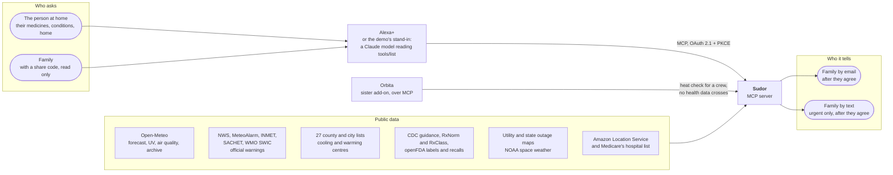
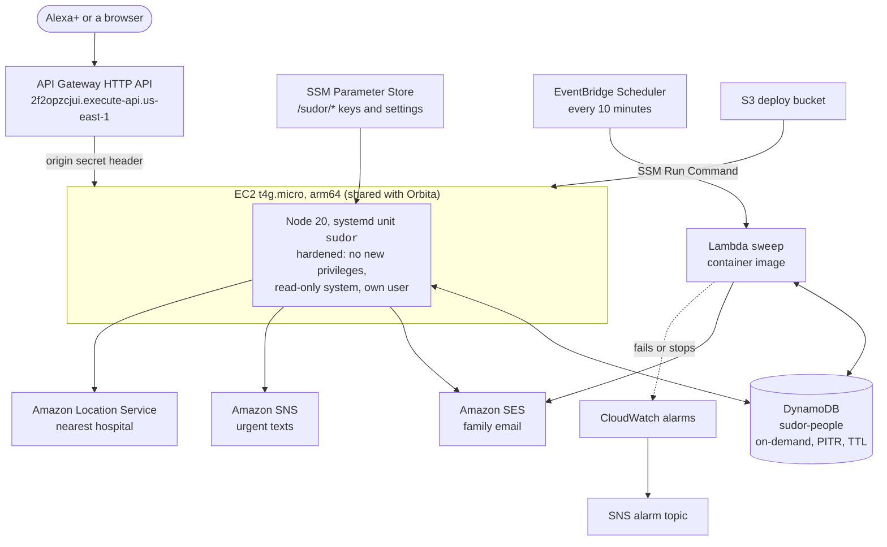
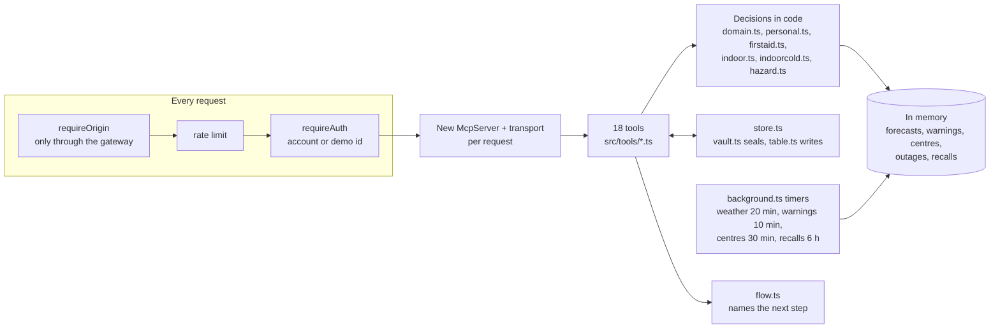
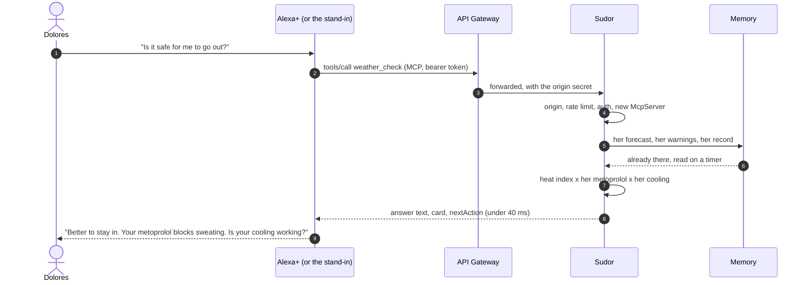
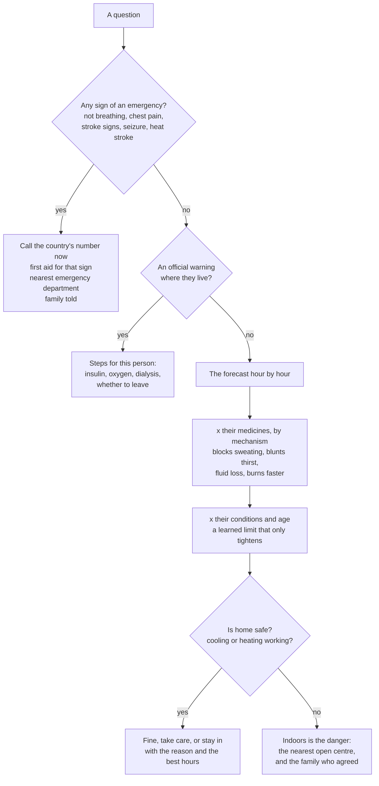
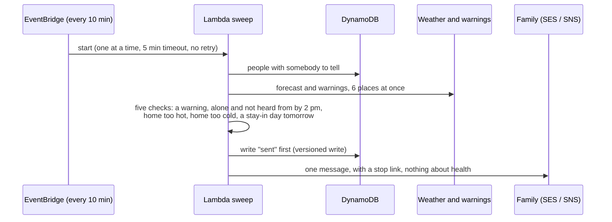
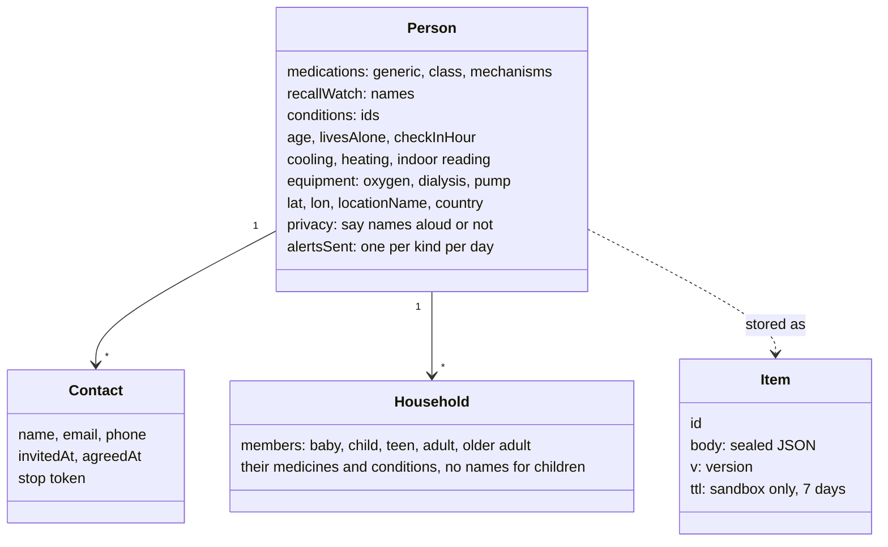
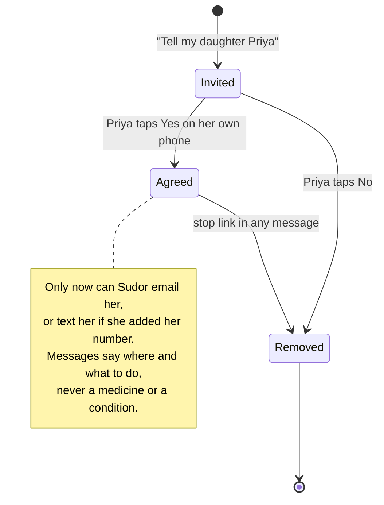
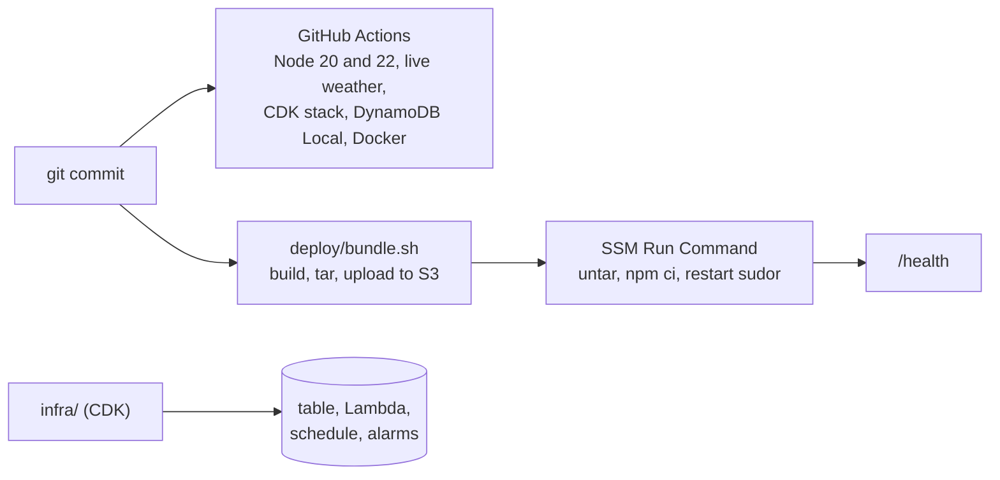

# Sudor: architecture

How Sudor is built, what runs where, and why. Every diagram below is drawn by GitHub from the text in this file, so
it can be zoomed and panned in place, and it changes when the file does. A printable copy is in
[architecture.pdf](architecture.pdf).

What is described here is what runs. It was checked against the AWS account on 23 October 2026: the people table holds
255 records, the alert check runs every ten minutes and both of its alarms read OK.

**Contents.** [At a glance](#at-a-glance) · [1. Context](#1-context-who-and-what-it-talks-to) ·
[2. On AWS](#2-on-aws-what-runs-where) · [3. Inside the server](#3-inside-the-server) ·
[4. A voice turn](#4-a-voice-turn-from-sentence-to-spoken-answer) · [5. The decision](#5-the-decision-for-this-body) ·
[6. Alerts](#6-alerts-when-nobody-asks) · [7. The data](#7-the-data-what-a-person-record-holds) ·
[8. Consent](#8-consent-who-may-be-told) · [9. Security and privacy](#9-security-and-privacy) ·
[10. Shipping it](#10-shipping-it) · [11. Decisions](#11-decisions-and-why)

## At a glance

| | |
|---|---|
| Protocol | MCP 2025-11-25 over Streamable HTTP, stateless: a new server and transport per request |
| Surface | 18 tools by default, an MCP Apps panel and card, an Agent Skill as `skill://` resources |
| Answer time | Under 40 ms at p95 for every in-memory tool ([LATENCY.md](../LATENCY.md)); Alexa+ allows about 500 ms |
| Data in | Weather, warnings, cooling centres, outages, recalls and space weather, read on timers, never inside a turn |
| Where it runs | One EC2 instance (t4g.micro, arm64) behind an API Gateway HTTP API, us-east-1, shared with Orbita |
| Where people live | DynamoDB `sudor-people`, one sealed item per person, versioned writes, on-demand |
| Alerts | A Lambda run by EventBridge Scheduler every 10 minutes, alarmed in CloudWatch |
| Telling the family | Amazon SES for email, Amazon SNS for urgent texts, only after the family member agrees |
| Code | TypeScript on Node 20, about 19,600 lines in `src/`, 2,835 automated checks |

## 1. Context: who and what it talks to

A person (or their family) asks; Alexa+, or the stand-in on the demo page, chooses a tool; Sudor answers from data it
already holds. Everything on the right is public data, read in the background.

## 2. On AWS: what runs where

The server and the alert check share nothing but the table. The server answers questions; the Lambda does the work
nobody is there to watch. If the server crashes the alerts still go, and if the alerts stop, an alarm says so.

## 3. Inside the server

A tool never calls the internet inside a turn. Somebody saying "I live in Phoenix" is answered at once, and the
place is looked up in the background (`locationStatus`), because geocoding alone can take longer than Alexa+ allows
for a whole turn.

## 4. A voice turn, from sentence to spoken answer

The model chooses the tool and says the words. It does not decide the answer: every verdict, number and safety line
is written by code, so no model can soften "call 911" or turn "stay in" into "probably fine".

## 5. The decision, for this body

A source that could not be read is never counted as safe: the answer says it could not check.

## 6. Alerts, when nobody asks

Writing what was sent before sending it means a crash can lose one email but never send two. The public demo never
sends anything, so sandbox records cost the check nothing.

## 7. The data: what a person record holds

In DynamoDB a person is one item: the record as JSON, sealed with AES-256-GCM when a data key is set, a version that
every write must match, and for sandbox records a TTL so DynamoDB deletes them itself after a week.

## 8. Consent: who may be told

## 9. Security and privacy

- **Health data sealed at rest.** AES-256-GCM, a fresh nonce per write, a key id for rotation, and the purpose bound in
  as associated data (`src/vault.ts`).
- **Only through the gateway.** The instance accepts a request only with the gateway's origin secret
  (`src/origin.ts`).
- **Account linking.** OAuth 2.1 with PKCE in the static-client shape Alexa+ uses (`src/auth.ts`).
- **The demo is fenced.** Each browser gets its own 128-bit sandbox id, never an account; the model has a daily cap and
  a per-caller burst limit; the demo never sends email or text.
- **Said aloud only if they want.** With privacy on, answers say "one of your medicines" instead of its name.
- **Keys in SSM**, never in the image or the repository.

## 10. Shipping it

## 11. Decisions, and why

- **Stateless MCP.** A new server per request is simple to reason about and lets two add-ons share one small instance.
- **Feeds on timers, answers from memory.** Alexa+ allows about half a second for a whole turn; a forecast fetch alone
  can take longer. So nothing external is called inside a turn.
- **The model talks; code decides.** The one place a model is allowed is choosing the tool and phrasing the words. The
  verdict is arithmetic over published guidance, so it can be tested, and it is: 2,835 checks.
- **Consent belongs to the person told.** The person at home cannot sign their family up. Each family member agrees on
  their own phone, and can stop with one tap.
- **The alert check is its own process.** It is the part nobody is there to watch, so it runs apart from the server and
  is alarmed when it fails or stops.
- **Honest about what it cannot do.** It cannot phone anyone or reach 911, and says so. A source it could not read is
  "could not check", never "all clear".
